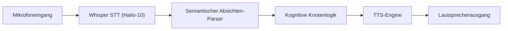

<!-- =============================================================================
HYDRA-UMC-VOICE-UI - Local speech-to-action front end
Copyright (C) JuanenRac (Electro Hobby 3D) <electrohobby3d@gmail.com>
GPL-3.0-or-later - see LICENSE
============================================================================= -->

<p align="center">
  
</p>

# 🎙️ HYDRA-UMC-VOICE-UI

<p align="center"><a href="README.md">🇺🇸 English</a> | <a href="README_spa.md">🇪🇸 Español</a> | <a href="README_fra.md">🇫🇷 Français</a> | <a href="README_ita.md">🇮🇹 Italiano</a> | 🇩🇪 <b>Deutsch</b> | <a href="README_zho.md">🇨🇳 简体中文</a> | <a href="README_jpn.md">🇯🇵 日本語</a> | <a href="README_por.md">🇵🇹 Português</a></p>

### 🔊 Lokale hardwarebeschleunigte Speech-to-Action-Pipeline

<p align="center">
  
  
  
  
  
  
</p>

---

> **Stand von Sicherheit (Safety) und Security:** Dieses Ökosystem ist kein zertifiziertes Sicherheitssystem. Es gibt noch keinen Hardware-E-STOP-Pfad, keine von der Firmware durchgesetzten Grenzen oder Verriegelungen und keinen verifizierten Bewegungsbefehl; Firmware-Images werden mit CRC-32 und einer Ed25519-Signatur geprüft, und ein Release-Build verweigert die veröffentlichten Entwicklungsschlüssel (die Werkzeugköpfe und Erweiterungsplatinen hinter dem Relais laufen noch mit URTC-Bootloadern, die statt einer Signatur ein HMAC-SHA256 mit gemeinsamem Schlüssel verwenden); TLS und gegenseitiges TLS sind optional und standardmäßig aus; noch keine eigene Platine wurde bestückt oder getestet. Lesen Sie die [Sicherheitsbasis](https://github.com/JuanenRac/HYDRA-UMC-DOCS/blob/main/docs/SECURITY_BASELINE.md) und das [Bedrohungsmodell](https://github.com/JuanenRac/HYDRA-UMC-DOCS/blob/main/docs/THREAT_MODEL.md), bevor Sie sich für die Sicherheit einer Person auf eine Aussage hier verlassen.

---

## 📋 Auf einen Blick

| | |
|---|---|
| Version | `0.1.9` |
| Reifegrad | Funktionsfähig |
| Tests | 239 (`python -m pytest -q tests`) |
| Technik | Python / Rule-based intent parser / Energy-gate VAD |
| Ziel | Der Raspberry Pi CM5 einer HYDRA-UMC-Zelle |
| Auf echter Hardware | Noch nicht: für diese Version ist kein Lauf auf echter Hardware vermerkt |

**Springe zu:** [Überblick](#-überblick) · [Architektur](#-architektur) · [Schnellstart](#-schnellstart) · [Tests](#-tests) · [Struktur des Repositorys](#-struktur-des-repositorys) · [Verwandte Projekte](#-verwandte-projekte)

## 🚦 Projektstatus

Jede Zeile ist ein Teil dieses Repositorys, und die Ampel sagt, wie weit er heute ist. Sie beruht auf dem, was das Repository zeigen kann (Tests, Builds, Läufe), nicht auf dem, was geplant ist.

🟢 Fertig und überprüft · 🟡 Funktioniert, mit bekannten Grenzen · 🟠 Teilweise fertig oder noch nicht überprüft · 🔴 Nicht gemacht oder funktioniert nicht

| Bereich | Stand | Was das hier bedeutet |
|---|---|---|
| Software | 🟡 | Funktioniert für seinen Hauptzweck; die Ehrlichkeitsprüfung oben nennt, was noch fehlt |
| Tests | 🟢 | 239 automatische Tests, bei jeder Änderung ausgeführt |
| Echte Hardware | 🔴 | Noch nicht: für diese Version ist kein Lauf auf echter Hardware vermerkt |
| Dokumentation | 🟢 | README in acht Sprachen, bei jeder Änderung gegen das Manifest geprüft |

## 🎯 Überblick

**HYDRA-UMC-VOICE-UI** ist die lokale Sprachinteraktionsschicht für das HYDRA-UMC-Ökosystem. Sie bietet eine Hochleistungs-STT- (Speech-to-Text) und TTS- (Text-to-Speech) Pipeline, die von der Hailo-10 NPU beschleunigt wird.

Sie ermöglicht es Bedienern, Robotermissionen zu steuern, den Systemstatus abzufragen und Audio-Feedback ohne jegliche Cloud-Konnektivität zu erhalten, was maximale Privatsphäre und null Latenz garantiert.

### Hauptmerkmale:
* 🎧 **Audio-Front-End (v0):** Echtes, rein stdlib-basiertes WAV-Laden und Sprachaktivitätserkennung per Energie-Schwellenwert. *(implementiert als echte Signalverarbeitungs-Primitive - nicht die Transkription selbst; siehe BUILD UND AUSFÜHRUNG unten)*
* 🎙️ **Edge STT:** Quantisierte Whisper-Modelle für eine fast sofortige Sprachtranskription. *(geplant - benötigt eine echte Modellabhängigkeit)*
* 📢 **Natürliches TTS:** Hochwertige Sprachsynthese für Systemwarnungen und Statusberichte. *(geplant)*
* 🧠 **NLU-Parser (v0):** Echte, regelbasierte Extraktion von Absicht/Entitäten aus erkanntem Text für den Semantic Planner. *(implementiert als Regex-Regeln über ein kleines echtes Befehlsvokabular - kein trainiertes ML-Modell; siehe BUILD UND AUSFÜHRUNG unten)*
* 🔀 **Ambiguitätsbewusste Klassifikation:** `classify_intent()` normalisiert Text (Unicode NFKC, Entfernen von Füllwörtern/Satzzeichen) und lehnt eine Transkription ab, die wirklich zu mehr als einem bekannten Befehl passt, statt stillschweigend einen zu erraten. *(implementiert; wird vom Watch-Voice-Gateway weiter unten verwendet)*
* 🔏 **Signierte Bestätigungen zur einmaligen Verwendung (v0):** Das `confirmationToken`, das einen Stopp, einen Missionsstart oder die Rückkehr zur Basis bestätigt, wird mit HMAC-SHA256 unter einem Serverschlüssel signiert (`HYDRA_UMC_VOICE_UI_CONFIRM_SECRET`, mindestens 16 Zeichen; ohne ihn wird pro Prozess ein zufälliger Schlüssel erzeugt), trägt einen zufälligen Nonce und wird nur einmal akzeptiert: eine zweite Verwendung desselben Tokens, ein von Hand gebautes Token für eine andere Absicht oder eines mit anderem Schlüssel wird als `invalid` abgelehnt. Zuvor war das Token ein SHA-256-Präfix seines eigenen Inhalts ohne Geheimnis, sodass jeder, der das Format kannte, eine gültige Bestätigung bauen konnte, und eine gültige ließ sich während ihrer 30 Sekunden wiederholen. Der OS-Installer erzeugt den Schlüssel zusammen mit den übrigen Gerätegeheimnissen. *(implementiert)*
* 🛑 **Ein gesprochenes Stopp wird nie zurückgehalten (Servereinstellung):** standardmäßig wird eine Stopp-Anfrage sofort beantwortet, ohne Bestätigungstoken und mit `priority: safety-stop`, damit ein Verbraucher daraus einen kontrollierten Halt machen kann (sie ersetzt nie den physischen NOT-HALT); das Starten einer Bewegung wird weiterhin bestätigt. `HYDRA_UMC_VOICE_UI_STOP_REQUIRES_CONFIRMATION=1` bringt die Bestätigung des Stopps zurück. *(implementiert)*
* 🎚️ **Risikostufe jeder gesprochenen Aktion (eine Datei):** Eine Statusabfrage ist informativ und ein Stopp wird sofort beantwortet; Missionsstart und Heimfahrt sind Bewegungen und brauchen immer eine Bestätigung. Die Tabelle wird aus `HYDRA_UMC_VOICE_UI_RISK_FILE` gelesen (Standard `/etc/hydra-umc/voice-ui-risk.json`, Beispiel in `deploy/voice-ui-risk.json.example`) und kann den Standard nur verschärfen: Ein Eintrag, der eine Aktion senkt, wird ignoriert, und eine fehlende oder defekte Datei lässt den Standard.
* 🔏 **Eine Bestätigung gilt für die Person, die gefragt hat, und ein bestätigtes Ergebnis lässt sich prüfen:** Ein Turn kann seinen `subject` nennen (den angemeldeten Benutzer, für den HYDRA-UMC-SERVER ihn weiterreicht); das signierte Bestätigungstoken trägt ihn und bestätigt nur für genau diesen Subject (eine Ablehnung verbraucht das Token nicht). Ein bestätigtes Ergebnis enthält außerdem `subject`, `confirmedAtUtc` und die einmalige `nonce` und, wenn `HYDRA_UMC_VOICE_UI_RESULT_KEY` (16 Zeichen oder mehr, derselbe Wert wie bei HYDRA-UMC-SERVER) gesetzt ist, eine HMAC-SHA256-`signature`, die der Server prüft, bevor er dem Ergebnis glaubt. `HYDRA_UMC_VOICE_UI_REQUIRE_SUBJECT=1` lehnt zusätzlich einen Turn oder eine Bestätigung ab, die niemanden nennt (standardmäßig aus). *(implementiert)*
* 🙈 **Die Antwort wiederholt nicht, was gesagt wurde (Servereinstellung):** standardmäßig nennt die Interpretation einer Antwort nur die zutreffenden Regeln; `HYDRA_UMC_VOICE_UI_INCLUDE_HEARD_TEXT=1` fügt das Transkript hinzu (`heardText`, `normalizedText`), das personenbezogene Daten sind. Grenzen: Die Regeln verstehen nur Englisch, und das `locale` eines Turns wird geprüft, aber nicht verwendet. Der Server kann ihn (und die Mindestsicherheit) für jeden Durchgang auch in seinem Bildschirm Server Admin setzen; die Umgebung dieses Dienstes hat Vorrang vor dem Server.
* 🛡️ **Rauschunterdrückung:** Optimiert für industrielle Umgebungen mit hohem Umgebungslärm. *(geplant)*
* 👨‍👩‍👧 **Kind des Cognitive AI Node:** Läuft als einer von vier
  Schwesterdiensten unter [HYDRA-UMC-COGNITIVE-NODE](https://github.com/JuanenRac/HYDRA-UMC-COGNITIVE-NODE)
  (neben VLA-Engine, Semantic-Planner und Docs-QA) und teilt sich das
  HydraOS-Image und die Modellgewichte des Elternteils, statt eigene
  Kopien vorzuhalten.

## 🧩 Rolle in HYDRA-UMC

**HYDRA-UMC-VOICE-UI** ist das Sprach-Frontend des kognitiven Knotens: Es erkennt Stimme in einer WAV-Datei, zerlegt bereits erkannten Text regelbasiert in eine Absicht und bietet ein begrenztes HTTP-Gateway für den Uhren-Ablauf, das vor jeder Weitergabe eine Bestätigung verlangt. Es erkennt noch keine Sprache und sendet nie einen physischen Befehl.

## 🏛️ Architektur

<p align="center">
  
</p>

<details>
<summary>Textversion des Diagramms (Mermaid)</summary>



</details>

### ARCHITEKTUR & DESIGNENTSCHEIDUNGEN

Dieses Repository ist ein **Kind** der Cognitive AI Node-Familie - sein
Elternteil, [HYDRA-UMC-COGNITIVE-NODE](https://github.com/JuanenRac/HYDRA-UMC-COGNITIVE-NODE),
besitzt das gemeinsam genutzte HydraOS-Image und die quantisierten
Modellgewichte und bindet diesen Dienst in seiner `docker-compose.yml`
neben seinen drei Geschwistern (VLA-Engine, Semantic-Planner, Docs-QA)
ein:

* **Warum dieses Kind keine eigene Hardware/Firmware/`os/`/`models/`
  hat.** Es läuft vollständig auf dem CM5 + Hailo-10 M.2-Modul, das
  bereits dem Elternteil gehört - Modellgewichte und HydraOS-Image an
  einer zentralen Stelle zu halten vermeidet vier abweichende, mehrere
  Gigabyte große Kopien innerhalb der Familie.
* **Warum ein `src/`-Layout.** Trennt das installierbare Paket
  (`hydra_umc_voice_ui`) vom Tooling im Repo-Root (`bump_version.py`)
  und entspricht dem Layout aller anderen Python-Projekte im Ökosystem.
* **Warum die nackte Ausführung nur Identität/Version/Rolle ausgibt.**
  Das bleibt eine dünne, unveränderte Gerüstprüfung; die echte
  v0-Arbeit steckt hinter ihren Unterbefehlen: `analyze-audio` (echtes
  WAV-Laden + Energie-Schwellen-VAD, `audio.py`), `parse-intent` (echte
  regelbasierte Intent-/Entitätsanalyse, `intent.py`), und `serve` (das
  echte authentifizierte Watch-Voice-Turn-Gateway, `http_service.py`/
  `gateway.py`). Nichts davon ist die Whisper-STT-/Neural-TTS-Pipeline,
  die die eigene Roadmap dieses READMEs beschreibt - das braucht
  weiterhin eine echte Modellabhängigkeit, die diese Umgebung nicht hat.
* **Wie sich das in den Rest des Ökosystems einfügt.** Dieser Dienst ist
  der freihändige Einstiegspunkt in den gesamten Cognitive AI Node:
  erkannte Absicht fließt zu seinem Geschwister
  HYDRA-UMC-SEMANTIC-PLANNER, und er fungiert neben HYDRA-UMC-STUDIO und
  HYDRA-UMC-DSI als Sprachsteuerungs-Oberfläche.
* **Warum `audio.py` `wave`/`array` statt numpy verwendet.** Das
  Dekodieren von 16-Bit-PCM und eine echte Energie-Schwellenwert-VAD
  brauchen nichts über das hinaus, was die stdlib bereits bietet - v0
  ohne Abhängigkeiten zu halten bedeutet, dass das echte Audio-Front-End
  überall läuft, wo Python läuft, noch bevor irgendeine
  Hailo-10-spezifische STT-Abhängigkeit installiert ist.
* **Warum `intent.py` echte Regex-Regeln sind, kein trainiertes
  NLU-Modell.** Ein kleines, echtes Befehlsvokabular
  (start/stop/status/go home) wird heute vollständig und ehrlich durch
  Regeln abgedeckt - dieselbe Überlegung wie der echte TF-IDF-Index des
  Geschwisterprojekts HYDRA-UMC-DOCS-QA anstelle eines
  Embedding-Modells: ein echter, testbarer Kern jetzt, den ein
  künftiger ML-basierter Klassifikator hinter demselben
  `parse_intent()`-Vertrag ersetzen kann, sobald erkannte Sprache mehr
  als dieses v0-Vokabular abdecken muss.
* **Warum nicht übereinstimmendes Audio/Text einen ehrlichen
  Fehlschlag liefert, keine Vermutung.** `detect_voice_segments()`
  liefert für Stille eine leere Liste, und `parse_intent()` liefert
  `None` für Text außerhalb seines Regelsatzes - v0 hat kein
  Rückfallmodell, erfindet also niemals ein Segment oder eine Absicht,
  die es tatsächlich nicht erkannt hat.
* **Warum das Watch-Gateway `classify_intent()` verwendet, nicht das
  alte `parse_intent()`.** `parse_intent()` bleibt für bestehende
  Aufrufer weiterhin "erste Übereinstimmung gewinnt" (unverändert,
  weiterhin so getestet), aber eine echte Transkription, die wirklich
  zu mehr als einem bekannten Befehl passt (z. B. enthält sowohl "stop"
  als auch "status"), ist eine echte, sicherheitsrelevante Mehrdeutigkeit
  für ein Gateway, dessen ganze Aufgabe darin besteht zu entscheiden, ob
  ein Bewegungsbefehl eine Bestätigung braucht - `classify_intent()`
  prüft jede Regel und meldet einen echten, eindeutig unterscheidbaren
  Mehrdeutigkeitsfall, statt ihn stillschweigend zu der Regel
  aufzulösen, die zufällig zuerst deklariert wurde.
* **Warum `normalize_text()` vor dem Abgleich Unicode NFKC anwendet.**
  Manche Speech-to-Text-Pipelines geben lateinische Buchstaben in voller
  Breite und andere Unicode-Kompatibilitätsformen aus - eigene
  Codepunkte, die sich von gewöhnlichem ASCII unterscheiden und daher
  für einen `\b...\b`-regulären Ausdruck nicht "das Wort" sind. NFKC
  reduziert sie zuerst auf ihr gewöhnliches Äquivalent, sodass ein
  Befehl, der semantisch mit einer bekannten Regel identisch ist,
  niemals nur wegen seiner Kodierung als ehrlicher Nicht-Treffer
  behandelt wird.

### WATCH-VOICE-GATEWAY (v0)

`python -m hydra_umc_voice_ui.main serve` stellt ein bewusst begrenztes lokales HTTP-Gateway für eine gekoppelte HYDRA-UMC-WATCH-Integration bereit: `GET /health`, `POST /v1/voice/turn` und `POST /v1/voice/confirm`. Das Gateway validiert die typisierte Nutzlast `voice_turn`, verwendet den vorhandenen deterministischen Intent-Parser und liefert `assistant_reply`; es steuert keine Roboter-Hardware.

Die Loopback-Entwicklung kann ohne Token laufen. Eine Bindung außerhalb von Loopback benötigt `HYDRA_UMC_VOICE_UI_TOKEN` sowie einen passenden Header `Authorization: Bearer`. Diese API überträgt niemals Roh-Audio, und bewegungsbezogene Intents liefern immer `requiresConfirmation: true` zusammen mit einem echten, begrenzten `confirmationToken` - der Watch-Client schickt ihn an `POST /v1/voice/confirm` zurück, das `confirmed`/`expired`/`invalid` meldet (nie ein bloßes Boolean), ohne selbst etwas auszulösen. Den vollständigen Vertrag siehe im Bestätigungsabschnitt von [WATCH_VOICE_GATEWAY.md](docs/WATCH_VOICE_GATEWAY.md) weiter unten.

Eine Transkription, die wirklich zu mehr als einem bekannten Befehl passt, wird mit einer echten, eindeutigen Antwort abgelehnt, statt stillschweigend zu einer Interpretation aufgelöst zu werden:

```json
// POST /v1/voice/turn
{"type": "voice_turn", "requestId": "watch-voice-001", "transcript": "stop the status check", "locale": "en-US"}

// -> {"type":"assistant_reply","requestId":"watch-voice-001","text":"That request matched more than one action (status, stop). Please rephrase it more specifically.","level":"ATTENTION","speak":true,"requiresConfirmation":false,"visualState":"clarification","interpretation":{"heardText":"stop the status check","normalizedText":"stop the status check","matchedRules":["status","stop"]}}
```

Siehe [WATCH_VOICE_GATEWAY.md](docs/WATCH_VOICE_GATEWAY.md) für den vollständigen Request-Vertrag und die Bereitstellungsgrenze, und [CLI_REFERENCE.md](docs/CLI_REFERENCE.md) für jedes reale `analyze-audio`/`parse-intent`/`serve`-Beispiel, aufgezeichnet vom installierten CLI.

## 🚀 Schnellstart

Benötigt Python 3.10 oder neuer.

```bash
./build.sh  # Linux, macOS (build.bat on Windows)
./run.sh analyze-audio clip.wav
./run.sh parse-intent "stop robot one"
./run.sh serve --port 8091
```

## 🧪 Tests

239 automatische Tests laufen mit `python -m pytest -q tests`. Sie brauchen weder Hardware noch etwas außerhalb dieses Rechners.

Die CI führt `HYDRA_UMC_CI=1 python tools/ci_validate.py` aus; das prüft das Manifest, die Dokumente, die acht READMEs und die Bilder.

## 🏗️ Build und Veröffentlichung

Erfordert Python >= 3.10.

```bash
# Linux / macOS / Git Bash
./build.sh   # erstellt .venv, installiert das Paket (editable), prüft den Import
./run.sh     # führt den Einstiegspunkt aus

# Windows (cmd)
build.bat
run.bat
```

`build.sh`/`build.bat` ändern die Version nie (nur `python tools/hydra_project_tool.py bump` erhöht sie) und führen die echte Testsuite
aus (`pytest tests/`). Erwartete Ausgabe eines `run.sh` ohne Argumente:

```text
HYDRA-UMC-VOICE-UI v0.1.9
Voice UI (Hailo-10) - local STT/TTS pipeline for hands-free robotic mission control.
```

Die echten Subcommands analysieren eine WAV-Datei oder verarbeiten
bereits transkribierten Text:

```bash
./run.sh analyze-audio recordings/command.wav
./run.sh parse-intent "start mission alpha"

# Windows
run.bat analyze-audio recordings\command.wav
run.bat parse-intent "status of robot 3"
```

### 🩺 Fehlerbehebung

* **`python: Befehl nicht gefunden` / der Build schlägt bei Schritt 1
  fehl.** Erfordert Python >= 3.10 im `PATH`. Unter Windows von
  [python.org](https://python.org) installieren und bei der Installation
  "Add to PATH" ankreuzen; unter Linux/macOS heißt es meist `python3`.
* **`build.sh` kann das venv nicht aktivieren.** `python3 -m venv .venv`
  legt das Aktivierungsskript je nach Plattform an anderer Stelle ab:
  `.venv/bin/activate` unter Linux/macOS, `.venv/Scripts/activate` unter
  Windows (auch bei einem Windows-Python-venv, das aus Git Bash heraus
  verwendet wird). `build.sh` prüft bereits beide Pfade - schlägt es
  weiterhin fehl, `.venv/` löschen und `./build.sh` erneut ausführen, um
  es von Grund auf neu zu erstellen.
* **`pip install -e .` schlägt fehl.** Meist wegen eines veralteten
  `.venv/`. Den Ordner `.venv/` löschen und `./build.sh`/`build.bat`
  erneut ausführen, um ihn neu zu erstellen.
* **`import OK` erscheint nie.** Bedeutet, dass `python -c "import
  hydra_umc_voice_ui"` selbst fehlgeschlagen ist - mit aktivem venv
  erneut ausführen, um den echten Traceback zu sehen.

## 📂 Struktur des Repositorys

<p align="center">
  
</p>

<details>
<summary>Textversion des Baums</summary>

```text
HYDRA-UMC-VOICE-UI/
├── src/hydra_umc_voice_ui/          Quellcode
│   ├── __init__.py                  Paketbeschreibung und Version
│   ├── audio.py                     Echtes WAV-Laden + Sprachaktivitätserkennung per Energie
│   ├── intent.py                    Echter regelbasierter Absicht-/Entitäten-Parser + ambiguitätsbewusstes classify_intent()
│   ├── gateway.py                   Begrenztes Text-zu-Intent-Gateway, geteilt mit dem Watch-Cognitive-Flow
│   ├── http_service.py              Kleine stdlib-HTTP-Grenze für den Watch-zu-Cognitive-Sprachpfad
│   ├── main.py                      Einstiegspunkt + echte Subcommands `analyze-audio`/`parse-intent`
│   └── ratelimit.py                 Ein Gleitfenster-Limit für Anfragen je Client-Adresse (damit ein Client die Bestätigungsliste nicht füllen kann)
├── tests/                           Echte Tests: WAV-Fixtures, VAD, Intent-Regeln, Gateway, End-to-End-CLI
├── docs/                            Dokumentation und Befehlskatalog
├── images/                          Medien und Diagramme
├── deploy/
├── systemd/                         Dienst-Unit
├── tools/                           Projektwerkzeuge und CI-Prüfungen
├── .github/                         CI-Workflow und Issue-Vorlagen
├── Dockerfile                       Minimales Container-Image für das authentifizierte HTTP-Gateway (non-root)
├── pyproject.toml                   Paketmetadaten
├── bump_version.py                  ausdrückliche Versionserhöhung
├── bump_manifest_version.py         Synchronisiert die Version von hydra-umc.project.json mit der nativen (--sync)
├── build.sh / build.bat             Erstellt das venv, installiert (mit Dev-Extras), prüft den Import, führt Tests aus
├── build-test.sh / build-test.bat   Nicht-mutierender Wrapper für tools/build_test.py (ändert weder Version noch Manifest noch CHANGELOG)
├── run.sh / run.bat                 Führt den Einstiegspunkt aus (leitet Argumente weiter, z. B. `analyze-audio`)
├── CHANGELOG.md                     was sich in jeder Version geändert hat
├── hydra-umc.project.json           Manifest: Version, Reifegrad, Familie
└── test.sh                          führt die Tests aus
```

</details>

## 🗺️ Roadmap und bekannte Grenzen

**Bekannte Grenzen heute**

* **Phase 1:** VLA-Engine-Bereitstellung und multimodale Eingabeverarbeitung auf Hailo-10.
* **Phase 2:** Integration des semantischen Planers mit Schwarmverhaltensmodellen und Langzeitgedächtnis.
* **Phase 3:** Lokale Ausführung der Voice-UI mit niedriger Latenz und industrielle Geräuschunterdrückung.
* **Phase 4:** Mehrsprachige Unterstützung (Englisch, Spanisch, Deutsch, Französisch) und vollständige Integration mit Dashboard AI.

## 🌍 Sprachen

Diese README und die Dokumente des Repositorys gibt es in acht Sprachen: Englisch, Spanisch, Deutsch, Französisch, Italienisch, Japanisch, Chinesisch und Portugiesisch (Portugal). Sie entstehen gemeinsam, und die CI prüft, dass die acht Dateien dieselben Abschnitte und dieselben Links haben. Dieses Repository hat weder eine eigene Oberfläche noch einen eigenen Meldungskatalog, es gibt also keine Oberflächentexte zu übersetzen.

## 🔗 Verwandte Projekte

Dieses Projekt ist Teil des HYDRA-UMC-Robotik-Ökosystems desselben Autors (JuanenRac / Electro Hobby 3D). Gut zu wissen, da eine Anfrage eigentlich eines dieser Projekte betreffen könnte statt dieses Repositorys.

**Übergeordnetes Projekt**
- **[HYDRA-UMC-COGNITIVE-NODE](https://github.com/JuanenRac/HYDRA-UMC-COGNITIVE-NODE)** — Integrationsknoten für die Hailo-10-Cognitive-Pipeline (LLM-/VLA-/Sprach-Orchestrierung); das übergeordnete Projekt, dessen spezifische Stufe bzw. Verbraucher dieses Repository innerhalb seiner eigenen Cognitive-Pipeline ist.

**Geschwisterprojekte** — die übrigen Stufen/Verbraucher der eigenen Hailo-10-Cognitive-Pipeline von HYDRA-UMC-COGNITIVE-NODE
- **[HYDRA-UMC-SEMANTIC-PLANNER](https://github.com/JuanenRac/HYDRA-UMC-SEMANTIC-PLANNER)** — echte regelbasierte Aufgabenzerlegung und semantische Fehlerbehebung über MCU-Fehlercodes.
- **[HYDRA-UMC-VLA-ENGINE](https://github.com/JuanenRac/HYDRA-UMC-VLA-ENGINE)** — echte Aktions-Token-Kodierung/-Dekodierung und Trajektoriengenerierung für ein Vision-Language-Action-Modell.
- **[HYDRA-UMC-DOCS-QA](https://github.com/JuanenRac/HYDRA-UMC-DOCS-QA)** — echte, nur auf der Standardbibliothek basierende TF-IDF-Dokumentensuche über die eigenen Markdown-Dokumente dieses Ökosystems.
- **[HYDRA-UMC-LOCAL-TECHNICIAN](https://github.com/JuanenRac/HYDRA-UMC-LOCAL-TECHNICIAN)** — lokaler, richtlinien-gesteuerter KI-Wartungstechniker für das Ökosystem selbst - beobachtet, diagnostiziert und schlägt Korrekturen vor; die zwei höchsten Risikostufen sind absichtlich noch nicht implementiert.

**Direkt verwandt**
- **[HYDRA-UMC-STUDIO](https://github.com/JuanenRac/HYDRA-UMC-STUDIO)** — Web-Steuerungs-Dashboard mit Echtzeit-3D-Visualisierung mehrerer Roboter; eine weitere Sprachsteuerungsoberfläche des Ökosystems, neben diesem Dienst.
- **[HYDRA-UMC-DSI](https://github.com/JuanenRac/HYDRA-UMC-DSI)** — native Touch-UI für das eingebaute 7"-DSI-Touchscreen, direkt auf dem CM5 eingebettet; eine weitere Sprachsteuerungsoberfläche des Ökosystems, neben diesem Dienst.

**Ebenfalls Teil des Ökosystems**

*Kern-Hardware & Plattform*
- **[HYDRA-UMC](https://github.com/JuanenRac/HYDRA-UMC)** — der Entwurf des Motherboards des Roboterarms: CM5-Host + Dual-Core-STM32H745, gedacht zur Koordination von bis zu 8 Werkzeugarmen über CAN-OTA/SPI-OTA (Firmware in einer frühen Phase; noch keine bestückte Platine).
- **[HYDRA-UMC-OS](https://github.com/JuanenRac/HYDRA-UMC-OS)** — reproduzierbare Raspberry-Pi-OS-Produktschicht für den CM5: schreibgeschützter Agent, validierte Konfiguration/Profile, WiFi-Ersteinrichtung.
- **[HYDRA-UMC-SDK](https://github.com/JuanenRac/HYDRA-UMC-SDK)** — der gemeinsame JSON-Schema-Vertrag und die Software-Auftragsschranke, gegen die jede Bridge ihre Befehle validiert (keine zertifizierte Sicherheitsfunktion).
- **[HYDRA-UMC-CONNECTOR-HUB](https://github.com/JuanenRac/HYDRA-UMC-CONNECTOR-HUB)** — deklaratives Adapter-Manifest-Register und Validator für Konnektoren externer Maschinen; erweitert die eigene Vertragsidee des SDK auf externe Maschinen, ohne die Industrie-Gateway-Projekte zu ersetzen.

*Kern-Backend & Clients*
- **[HYDRA-UMC-SERVER](https://github.com/JuanenRac/HYDRA-UMC-SERVER)** — das reale Headless-Backend (REST/WebSocket), mit dem jeder Steuerungsclient tatsächlich spricht.
- **[HYDRA-UMC-SUITE](https://github.com/JuanenRac/HYDRA-UMC-SUITE)** — Desktop-Schwarmleitstand (PySide6) für mehrere Server gleichzeitig, verpackt als eigenständige ausführbare Datei.
- **[HYDRA-UMC-ANDROID-CONTROL](https://github.com/JuanenRac/HYDRA-UMC-ANDROID-CONTROL)** — native Android-Steuerungs-App mit biometrischem Login und einer gekoppelten Wear-OS-Begleit-App.
- **[HYDRA-UMC-IOS-CONTROL](https://github.com/JuanenRac/HYDRA-UMC-IOS-CONTROL)** — iOS/iPadOS-Steuerungs-App (Flutter) mit Echtzeit-WebSocket-Synchronisierung.
- **[HYDRA-UMC-EDITOR-URDF](https://github.com/JuanenRac/HYDRA-UMC-EDITOR-URDF)** — grafischer Desktop-URDF-Ersteller/-Editor, der fertige Modelle in STUDIOs eigenen Katalog überträgt.
- **[HYDRA-UMC-EDITOR-STL](https://github.com/JuanenRac/HYDRA-UMC-EDITOR-STL)** — Desktop-STL-Modelleditor, der echte Teile im selben Modellkatalog transformiert/ersetzt/entfernt/hinzufügt, den auch HYDRA-UMC-EDITOR-URDF bearbeitet.
- **[HYDRA-UMC-BRIDGE-AMR](https://github.com/JuanenRac/HYDRA-UMC-BRIDGE-AMR)** — Koordinationsschranke für AGV-/AMR-Flotten über einen VDA-5050-MQTT-Publisher (nur gegen eine emulierte Flotte getestet).
- **[HYDRA-UMC-BRIDGE-CNC](https://github.com/JuanenRac/HYDRA-UMC-BRIDGE-CNC)** — High-Level-Koordinator für CNC-Zellen mit GRBL-Status-/Steuerbyte-Zugriff (nur gegen einen Emulator getestet).
- **[HYDRA-UMC-BRIDGE-DROIDS](https://github.com/JuanenRac/HYDRA-UMC-BRIDGE-DROIDS)** — Koordinationsschranke für laufende/humanoide Droiden, mit einem Boston-Dynamics-Spot-Befehlssender (nur gegen einen Emulator getestet).
- **[HYDRA-UMC-BRIDGE-LASER](https://github.com/JuanenRac/HYDRA-UMC-BRIDGE-LASER)** — Koordinator für Laserzellen, liest 3 Schlüssel-/Gehäuse-/Verriegelungs-GPIO-Signale (nur gegen einen simulierten Chip getestet; kann keinen Laser scharfschalten oder auslösen).
- **[HYDRA-UMC-BRIDGE-OPENPNP](https://github.com/JuanenRac/HYDRA-UMC-BRIDGE-OPENPNP)** — sicherer High-Level-Koordinator für den Leiterplattenfluss von OpenPnP Pick-and-Place.
- **[HYDRA-UMC-BRIDGE-PRINTER3D](https://github.com/JuanenRac/HYDRA-UMC-BRIDGE-PRINTER3D)** — sichere Koordinationsschranke für Moonraker/Klipper-3D-Drucker, mit echten gesicherten Job-Befehlen.
- **[HYDRA-UMC-BRIDGE-ROS2](https://github.com/JuanenRac/HYDRA-UMC-BRIDGE-ROS2)** — Koordinator mit einem träge importierten rclpy-ROS-2-Transport (noch nicht gegen eine ROS-2-Installation ausgeführt).
- **[HYDRA-UMC-BRIDGE-UAV](https://github.com/JuanenRac/HYDRA-UMC-BRIDGE-UAV)** — Koordinationsschranke für kameraausgestattete UAVs, mit einem MAVLink-Befehlssender (nur gegen einen Emulator getestet).

*URTC-Werkzeugplattform*
- **[URTC](https://github.com/JuanenRac/URTC)** — Firmware für die physische Universal-Robot-Tool-Controller-Platine, 25+ Werkzeugprofile über CAN-Bus.
- **[URTC-FLASHER](https://github.com/JuanenRac/URTC-FLASHER)** — Desktop-GUI-Flash-Tool für URTC-Platinen, CAN-OTA plus Full-Chip-SWD/JTAG.
- **[URTC-TESTER](https://github.com/JuanenRac/URTC-TESTER)** — Desktop-Live-CAN-Bus-Diagnosetool für URTC-Platinen, ein Panel pro Werkzeugprofil.
- **[URTC-WEB-STUDIO](https://github.com/JuanenRac/URTC-WEB-STUDIO)** — browserbasierte Alternative zu URTC-TESTER über die Web-Serial-API, ohne lokale Installation.
- **[URTC-GATEWAY](https://github.com/JuanenRac/URTC-GATEWAY)** — Gateway vor dem CAN-Bus von URTC: Liste erlaubter Kennungen, Ratenbegrenzung und Sitzungsschlüssel; Software auf dem Computer getestet, noch nicht an einem echten Bus.

*Vision-KI-Knoten (Hailo-8)*
- **[HYDRA-UMC-VISION-NODE](https://github.com/JuanenRac/HYDRA-UMC-VISION-NODE)** — Integrationsknoten für die Hailo-8-Vision-Pipeline, mit einer echten stufenweisen Hardware-Bereitschaftsprüfung.
- **[HYDRA-UMC-DETECTION-HEF](https://github.com/JuanenRac/HYDRA-UMC-DETECTION-HEF)** — echte Registry für kompilierte Modelle mit Hailo-Architektur-/Prüfsummen-Safe-Load-Verifizierung.
- **[HYDRA-UMC-VISION-STREAMER](https://github.com/JuanenRac/HYDRA-UMC-VISION-STREAMER)** — echter GStreamer-Pipeline- + MediaMTX-Konfigurationsgenerator mit einer echten HailoRT-Integrationsschranke.
- **[HYDRA-UMC-VISUAL-SERVOING-API](https://github.com/JuanenRac/HYDRA-UMC-VISUAL-SERVOING-API)** — Position-Based-Visual-Servoing-Korrekturgesetz mit Freigabe abhängig vom Zonenstatus; noch keine Posenschätzung per Kamera.
- **[HYDRA-UMC-SAFETY-ZONES](https://github.com/JuanenRac/HYDRA-UMC-SAFETY-ZONES)** — v0-Logik für Zonenverletzung, Kalibrierungsaktualität und E-STOP-Anforderung, die Objektpositionen aus einer Datei nimmt; kein Detektor speist sie, und noch kein physischer E-STOP ist angeschlossen.

*Orchestrierung & Schwarm*
- **[HYDRA-UMC-ORCHESTRATOR](https://github.com/JuanenRac/HYDRA-UMC-ORCHESTRATOR)** — Integrationsknoten mit einem echten gRPC/Protobuf-Health-Report-Vertrag und einer Missions-Zustandsmaschine.
- **[HYDRA-UMC-JOB-DISPATCHER](https://github.com/JuanenRac/HYDRA-UMC-JOB-DISPATCHER)** — echte prioritätsbasierte Job-Queue mit Deduplizierung, über eine echte HTTP-API.
- **[HYDRA-UMC-NODE-HEALING](https://github.com/JuanenRac/HYDRA-UMC-NODE-HEALING)** — echter gRPC-basierter Flotten-Health-Watchdog mit Retry/Backoff und Identitäts-Mismatch-Erkennung.
- **[HYDRA-UMC-PATH-PLANNER-3D](https://github.com/JuanenRac/HYDRA-UMC-PATH-PLANNER-3D)** — echter RRT-basierter 3D-Pfadplaner mit echter Hindernis-/Arbeitsraum-Kollisionsvalidierung.
- **[HYDRA-UMC-SWARM-SYNC](https://github.com/JuanenRac/HYDRA-UMC-SWARM-SYNC)** — echte CRDT-LWW-Element-Map-Zustandssynchronisation, eigenschaftsgetestet auf Multi-Zellen-Konvergenz.

*Digitaler Zwilling & Simulation*
- **[HYDRA-UMC-TWIN](https://github.com/JuanenRac/HYDRA-UMC-TWIN)** — Integrationsknoten für die Digital-Twin-Engine, mit einem echten Versionskompatibilitäts-Sync-Vertrag.
- **[HYDRA-UMC-HIL-BRIDGE](https://github.com/JuanenRac/HYDRA-UMC-HIL-BRIDGE)** — Hardware-in-the-Loop-Router mit einer Software-Kollisionsverriegelung zwischen Simulation und echter Hardware (ohne echte Hardware getestet).
- **[HYDRA-UMC-PHYSICS-REPLICA](https://github.com/JuanenRac/HYDRA-UMC-PHYSICS-REPLICA)** — echte Vorwärtskinematik und Gelenkgrenzenvalidierung über eine echte URDF-Teilmenge.
- **[HYDRA-UMC-SYNTHETIC-DATA-GEN](https://github.com/JuanenRac/HYDRA-UMC-SYNTHETIC-DATA-GEN)** — echter prozeduraler 2D-Szenengenerator mit YOLO/COCO-Annotationsexport.

*Daten & Analytik*
- **[HYDRA-UMC-DATALAKE](https://github.com/JuanenRac/HYDRA-UMC-DATALAKE)** — echter sqlite3-gestützter Zeitreihenspeicher mit einer echten Ingest-/Abfrage-HTTP-API.
- **[HYDRA-UMC-ANOMALY-DETECTOR](https://github.com/JuanenRac/HYDRA-UMC-ANOMALY-DETECTOR)** — echter FFT- + statistischer Basislinien-Anomaliedetektor mit Drift-Überwachung.
- **[HYDRA-UMC-PRODUCTION-REPORTS](https://github.com/JuanenRac/HYDRA-UMC-PRODUCTION-REPORTS)** — echte OEE-/Verfügbarkeitsberechnung über den DATALAKE-Verlauf, mit reproduzierbarem CSV-Export.
- **[HYDRA-UMC-TELEMETRY-COLLECTOR](https://github.com/JuanenRac/HYDRA-UMC-TELEMETRY-COLLECTOR)** — echte CAN/WebSocket-Ingestion-Pipeline in DATALAKE, mit Sequenz-Deduplizierung.

*Industrie-Gateway*
- **[HYDRA-UMC-GATEWAY-INDUSTRIAL](https://github.com/JuanenRac/HYDRA-UMC-GATEWAY-INDUSTRIAL)** — Integrationsknoten, der zu Industrieprotokollen weiterleitet, mit einer echten Befehls-Allowlist-/Backpressure-Schicht.
- **[HYDRA-UMC-OPCUA-SERVER](https://github.com/JuanenRac/HYDRA-UMC-OPCUA-SERVER)** — echter OPC-UA-Adressraum, verifiziert mit einer echten Binärprotokoll-Client-Session.
- **[HYDRA-UMC-MQTT-BROKER](https://github.com/JuanenRac/HYDRA-UMC-MQTT-BROKER)** — echter MQTT-Broker mit optionaler Pro-Client-Authentifizierung und Topic-ACLs.
- **[HYDRA-UMC-MTCONNECT-ADAPTER](https://github.com/JuanenRac/HYDRA-UMC-MTCONNECT-ADAPTER)** — echte MTConnect-`/probe`- und `/current`-XML-Endpunkte mit Degraded-Mode-Ausgabe.

*Ergänzende Tools & Ökosystembetrieb*
- **[HYDRA-UMC-DASHBOARD-AI](https://github.com/JuanenRac/HYDRA-UMC-DASHBOARD-AI)** — Smart-Summaries- und Anomaly-Highlighting-Panels über DATALAKE/ANOMALY-DETECTOR, mit einem ehrlichen statistischen Fallback.
- **[HYDRA-UMC-TOOL-CLI](https://github.com/JuanenRac/HYDRA-UMC-TOOL-CLI)** — Flotten-CLI mit einem echten, stabilen Exit-Code-Vertrag, ein echter Live-Client der eigenen API von HYDRA-UMC-SERVER.
- **[HYDRA-UMC-WATCH](https://github.com/JuanenRac/HYDRA-UMC-WATCH)** — WearOS-Begleit-App mit haptischen Alarmmustern und einem Sprach-Relay zum gekoppelten Telefon (noch nicht auf einer physischen Uhr ausgeführt).
- **[URTC-SMART-RACK](https://github.com/JuanenRac/URTC-SMART-RACK)** — Firmware für ein Platinenmontagegestell mit echter Werkzeug-ID-Dekodierung und Smart-Idle-Vorheizlogik.
- **[URTC-VISION-TOOL](https://github.com/JuanenRac/URTC-VISION-TOOL)** — Firmware plus ein echter Python-Vision-Begleiter für einen Thermal-/RGB-Inspektionswerkzeugkopf.
- **[HYDRA-UMC-UPDATER](https://github.com/JuanenRac/HYDRA-UMC-UPDATER)** — administratives Desktop-Tool, das jedes Repository in diesem Ökosystem entdeckt, klont und aktualisiert.
- **[HYDRA-UMC-OS-REBUILDER](https://github.com/JuanenRac/HYDRA-UMC-OS-REBUILDER)** — Windows/Linux-Desktop-Tool, das ein flashbereites CM5-Image baut, vorgeladen mit den aktuellsten Versionen des Ökosystems, mit Ersteinrichtungs-Konfiguration für WLAN/Benutzer/SSH im Stil von Raspberry Pi Imager.
- **[HYDRA-UMC-OPS-AGENT](https://github.com/JuanenRac/HYDRA-UMC-OPS-AGENT)** — Wartungsvorfall-Koordinator: eine Edge-Rolle mit niedrigem Privileg sammelt einen bereinigten Inventar-/Gesundheits-Snapshot, eine Control-Plane-Rolle rendert ihn schreibgeschützt und bittet einen KI-Anbieter um einen Diagnosevorschlag - wendet nie einen Patch an und stellt nie etwas bereit.
- **[HYDRA-UMC-DEV-SERVER](https://github.com/JuanenRac/HYDRA-UMC-DEV-SERVER)** — reproduzierbarer Entwicklungshost (Raspberry Pi 5 / CM5), der den Quellcode des Ökosystems vorhält und begrenzte Build-/Test-Aufgaben über eine dauerhafte Warteschlange ausführt; eine dedizierte Entwicklerrolle, ausdrücklich kein operativer CM5.

## 📚 Dokumentation

Hier steht mehr:

* [Sicherheitsgrundlage des Ökosystems](https://github.com/JuanenRac/HYDRA-UMC-DOCS/blob/main/docs/SECURITY_BASELINE.md)
* [Bedrohungsmodell des Ökosystems](https://github.com/JuanenRac/HYDRA-UMC-DOCS/blob/main/docs/THREAT_MODEL.md)
* [Änderungsprotokoll dieses Repositorys](CHANGELOG.md)
* [Lizenz dieses Repositorys](LICENSE.md)

## 🤝 Mitwirken und Community

* Führe vor einem Pull Request `HYDRA_UMC_CI=1 py -3 tools/ci_validate.py` (oder `HYDRA_UMC_CI=1 python3 tools/ci_validate.py`) aus: Es muss `CI_VALIDATION=PASS` ausgeben. Führe dafür nicht `build.sh` oder `build.bat` aus; Bauen ist keine Prüfung.
* Die acht READMEs entstehen aus einer einzigen Quelle in HYDRA-UMC-DOCS; bearbeite sie nicht von Hand. Ändere die Quelle und schreibe sie mit `tools/make_readmes.py` neu.
* Behaupte in einer README nichts, was nicht gelaufen ist: Schreibe „simuliert“ oder „nicht auf Hardware erprobt“, wo das stimmt.
* Siehe [CONTRIBUTING.md](CONTRIBUTING.md), den [Verhaltenskodex](CODE_OF_CONDUCT.md), [SECURITY.md](SECURITY.md) und [SUPPORT.md](SUPPORT.md).

## 👤 AUTOR

**JuanenRac (Electro Hobby 3D)** · electrohobby3d@gmail.com

## 📜 LIZENZ

GPL-3.0-or-later - [LICENSE](LICENSE).
