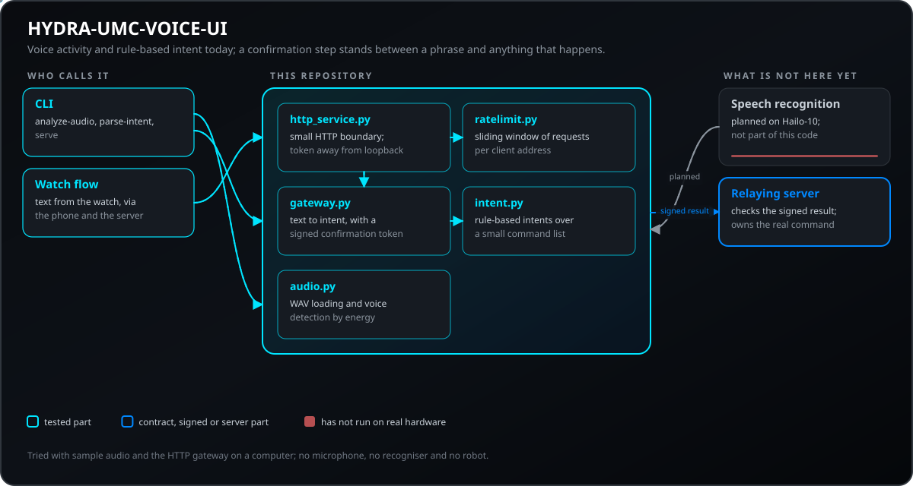
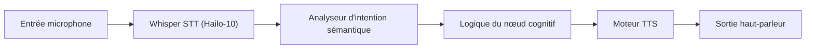
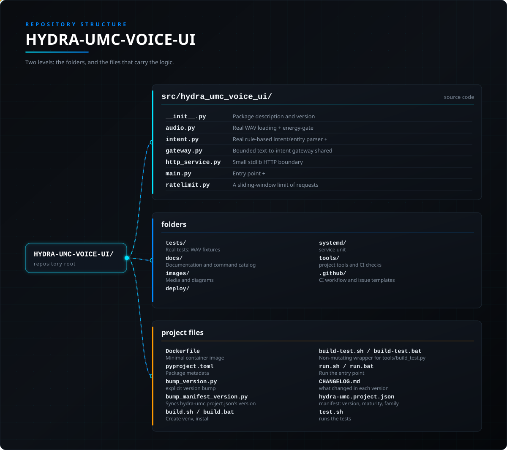

<!-- =============================================================================
HYDRA-UMC-VOICE-UI - Local speech-to-action front end
Copyright (C) JuanenRac (Electro Hobby 3D) <electrohobby3d@gmail.com>
GPL-3.0-or-later - see LICENSE
============================================================================= -->

<p align="center">
  
</p>

# 🎙️ HYDRA-UMC-VOICE-UI

<p align="center"><a href="README.md">🇺🇸 English</a> | <a href="README_spa.md">🇪🇸 Español</a> | 🇫🇷 <b>Français</b> | <a href="README_ita.md">🇮🇹 Italiano</a> | <a href="README_deu.md">🇩🇪 Deutsch</a> | <a href="README_zho.md">🇨🇳 简体中文</a> | <a href="README_jpn.md">🇯🇵 日本語</a> | <a href="README_por.md">🇵🇹 Português</a></p>

### 🔊 Pipeline Speech-to-Action locale accélérée par le matériel

<p align="center">
  
  
  
  
  
  
</p>

---

> **État de la sûreté et de la cybersécurité :** cet écosystème n'est pas un système de sécurité certifié. Il n'existe pas encore de chaîne d'E-STOP matérielle, ni de limites ou de verrouillages imposés par le firmware, ni de commande de mouvement vérifiée ; les images de firmware sont contrôlées par CRC-32 et une signature Ed25519, et une compilation de version refuse les clés de développement publiées (les têtes d'outil et les cartes d'extension derrière le relais utilisent encore les chargeurs d'URTC, qui prennent un HMAC-SHA256 à clé partagée au lieu d'une signature) ; TLS et TLS mutuel sont optionnels et désactivés par défaut ; aucune carte propre n'a encore été assemblée ni testée. Lisez la [base de sécurité](https://github.com/JuanenRac/HYDRA-UMC-DOCS/blob/main/docs/SECURITY_BASELINE.md) et le [modèle de menaces](https://github.com/JuanenRac/HYDRA-UMC-DOCS/blob/main/docs/THREAT_MODEL.md) avant de vous fier à une affirmation d'ici pour la sécurité d'une personne.

---

## 📋 En un coup d'œil

| | |
|---|---|
| Version | `0.1.9` |
| Maturité | Fonctionnel |
| Tests | 195 (`python -m pytest -q tests`) |
| Technologie | Python / Rule-based intent parser / Energy-gate VAD |
| Cible | Le Raspberry Pi CM5 d'une cellule HYDRA-UMC |
| Sur matériel réel | Pas encore : aucune exécution sur du matériel réel n'est consignée pour cette version |

**Aller à :** [Présentation](#-présentation) · [Architecture](#-architecture) · [Démarrage rapide](#-démarrage-rapide) · [Tests](#-tests) · [Structure du dépôt](#-structure-du-dépôt) · [Projets liés](#-projets-liés)

## 🚦 État du projet

Chaque ligne est une partie de ce dépôt et le feu dit où elle en est aujourd'hui. Elle est écrite d'après ce que le dépôt peut montrer (tests, compilations, exécutions), pas d'après ce qui est prévu.

🟢 Fait et vérifié · 🟡 Fonctionne, avec des limites connues · 🟠 À moitié fait ou pas encore vérifié · 🔴 Pas fait ou ne fonctionne pas

| Domaine | État | Ce que cela veut dire ici |
|---|---|---|
| Logiciel | 🟡 | Fonctionne pour son usage principal ; la vérification d'honnêteté ci-dessus liste ce qui manque encore |
| Tests | 🟢 | 195 tests automatiques, exécutés à chaque modification |
| Matériel réel | 🔴 | Pas encore : aucune exécution sur du matériel réel n'est consignée pour cette version |
| Documentation | 🟢 | README en huit langues, vérifié par rapport au manifeste à chaque modification |

## 🎯 Présentation

**HYDRA-UMC-VOICE-UI** est la couche d'interaction vocale locale pour l'écosystème HYDRA-UMC. Il fournit un pipeline STT (Speech-to-Text) et TTS (Text-to-Speech) haute performance accéléré par le NPU Hailo-10.

Il permet aux opérateurs de contrôler les missions robotiques, de consulter l'état du système et de recevoir un retour audio sans aucune connectivité cloud, garantissant une confidentialité maximale et une latence nulle.

### Caractéristiques principales :
* 🎧 **Front-end audio (v0) :** Chargement WAV réel, stdlib pur, et détection d'activité vocale par seuil d'énergie. *(implémenté comme une vraie primitive de traitement du signal - pas la transcription elle-même ; voir BUILD ET EXÉCUTION ci-dessous)*
* 🎙️ **Edge STT :** Modèles Whisper quantifiés pour une transcription vocale quasi instantanée. *(prévu - nécessite une vraie dépendance de modèle)*
* 📢 **TTS naturel :** Synthèse vocale de haute qualité pour les alertes système et les rapports d'état. *(prévu)*
* 🧠 **Analyseur NLU (v0) :** Extraction réelle d'intention/entités du texte reconnu, à base de règles, pour le planificateur sémantique. *(implémenté comme des règles regex sur un petit vocabulaire réel de commandes - pas un modèle de ML entraîné ; voir BUILD ET EXÉCUTION ci-dessous)*
* 🔀 **Classification consciente de l'ambiguïté :** `classify_intent()` normalise le texte (Unicode NFKC, suppression des mots de remplissage/ponctuation) et rejette une transcription qui correspond réellement à plus d'une commande connue au lieu de deviner silencieusement laquelle. *(implémenté ; utilisé par la passerelle vocale Watch ci-dessous)*
* 🔏 **Confirmations signées à usage unique (v0) :** le `confirmationToken` qui confirme un arrêt, un démarrage de mission ou un retour à la base est signé en HMAC-SHA256 avec une clé du serveur (`HYDRA_UMC_VOICE_UI_CONFIRM_SECRET`, au moins 16 caractères ; sans elle, une clé aléatoire est créée par processus), porte un nonce aléatoire et n'est accepté qu'une fois : un second usage du même jeton, un jeton pour une autre intention assemblé à la main ou signé avec une autre clé est refusé comme `invalid`. Auparavant, le jeton était un préfixe SHA-256 de son propre contenu sans secret : quiconque connaissait le format pouvait fabriquer une confirmation valide, et une confirmation valide pouvait être rejouée pendant ses 30 secondes. L'installateur d'OS génère la clé avec les autres secrets de l'appareil. *(implémenté)*
* 🛑 **Un arrêt vocal n'est jamais retenu (réglage du serveur) :** par défaut une demande d'arrêt reçoit une réponse immédiate, sans jeton de confirmation et avec `priority: safety-stop` pour qu'un consommateur en fasse un arrêt contrôlé (elle ne remplace jamais l'arrêt d'urgence physique) ; démarrer un mouvement reste confirmé. `HYDRA_UMC_VOICE_UI_STOP_REQUIRES_CONFIRMATION=1` rétablit la confirmation de l'arrêt. *(implémenté)*
* 🔏 **Une confirmation vaut pour la personne qui a demandé, et un résultat confirmé peut être vérifié :** un tour peut nommer son `subject` (l'utilisateur connecté pour qui HYDRA-UMC-SERVER le relaie) ; le jeton de confirmation signé le porte et ne confirme que pour ce même sujet (un refus ne consomme pas le jeton). Un résultat confirmé porte aussi `subject`, `confirmedAtUtc` et le `nonce` à usage unique et, si `HYDRA_UMC_VOICE_UI_RESULT_KEY` (16 caractères ou plus, la même valeur que détient HYDRA-UMC-SERVER) est définie, une `signature` HMAC-SHA256 que le serveur vérifie avant de croire le résultat. `HYDRA_UMC_VOICE_UI_REQUIRE_SUBJECT=1` refuse en plus un tour ou une confirmation qui ne nomme personne (désactivé par défaut). *(implémenté)*
* 🙈 **La réponse ne répète pas ce qui a été dit (réglage du serveur) :** par défaut l'interprétation d'une réponse ne liste que les règles reconnues ; `HYDRA_UMC_VOICE_UI_INCLUDE_HEARD_TEXT=1` ajoute la transcription (`heardText`, `normalizedText`), qui est une donnée personnelle. Limites : les règles ne comprennent que l'anglais, et le `locale` d'un tour est vérifié mais pas utilisé. Le Server peut aussi le fixer (ainsi que la confiance minimale) à chaque tour depuis son écran Server Admin ; l'environnement de ce service l'emporte sur le Server.
* 🛡️ **Suppression du bruit :** Optimisé pour les environnements industriels avec un bruit ambiant élevé. *(prévu)*
* 👨‍👩‍👧 **Enfant du Cognitive AI Node :** Fonctionne comme l'un des
  quatre services frères sous [HYDRA-UMC-COGNITIVE-NODE](https://github.com/JuanenRac/HYDRA-UMC-COGNITIVE-NODE)
  (aux côtés de VLA-Engine, Semantic-Planner et Docs-QA), partageant
  l'image HydraOS et les poids de modèles de son parent au lieu de
  conserver ses propres copies.
* 📦 **Versionnage compteur kilométrique :** La version de `pyproject.toml` n'est augmentée que par la commande `bump` explicite (`python tools/hydra_project_tool.py bump`, qui exécute `bump_version.py`) - compiler ne la change jamais.

## 🧩 Rôle dans HYDRA-UMC

**HYDRA-UMC-VOICE-UI** est l'entrée vocale du nœud cognitif : il détecte la voix dans un fichier WAV, analyse par règles un texte déjà reconnu pour en tirer une intention et propose une passerelle HTTP bornée pour le flux de la montre, qui demande une confirmation avant de transmettre quoi que ce soit. Il ne reconnaît pas encore la parole et n'envoie jamais de commande physique.

## 🏛️ Architecture

<p align="center">
  
</p>

<details>
<summary>Version texte du diagramme (Mermaid)</summary>



</details>

### ARCHITECTURE & DÉCISIONS DE CONCEPTION

Ce dépôt est un **enfant** de la famille Cognitive AI Node - son parent,
[HYDRA-UMC-COGNITIVE-NODE](https://github.com/JuanenRac/HYDRA-UMC-COGNITIVE-NODE),
détient l'image HydraOS partagée et les poids de modèles quantifiés, et
relie ce service dans son `docker-compose.yml` aux côtés de ses trois
frères (VLA-Engine, Semantic-Planner, Docs-QA) :

* **Pourquoi cet enfant n'a pas de matériel/firmware/`os/`/`models/`
  propres.** Il fonctionne entièrement sur le module CM5 + Hailo-10 M.2
  déjà détenu par le parent - centraliser les poids de modèles et
  l'image HydraOS à un seul endroit évite quatre copies divergentes de
  plusieurs gigaoctets au sein de la famille.
* **Pourquoi une structure `src/`.** Sépare le paquet installable
  (`hydra_umc_voice_ui`) de l'outillage à la racine du dépôt
  (`bump_version.py`), conformément au reste des projets Python de
  l'écosystème.
* **Pourquoi l'invocation nue se contente d'afficher
  identité/version/rôle.** Cela reste une vérification d'échafaudage
  légère et inchangée ; le vrai travail v0 se trouve derrière ses
  sous-commandes : `analyze-audio` (vrai chargement WAV + détection
  d'activité vocale par seuil d'énergie, `audio.py`), `parse-intent`
  (vraie analyse d'intention/entité basée sur des règles, `intent.py`),
  et `serve` (la vraie passerelle authentifiée de tours de voix pour le
  Watch, `http_service.py`/`gateway.py`). Rien de tout cela n'est le
  pipeline Whisper STT / TTS neuronal que la feuille de route de ce
  README décrit elle-même - cela nécessite encore une vraie dépendance de
  modèle que cet environnement n'a pas.
* **Comment cela s'intègre dans le reste de l'écosystème.** Ce service
  est le point d'entrée mains libres de tout le Cognitive AI Node :
  l'intention reconnue circule vers son frère
  HYDRA-UMC-SEMANTIC-PLANNER, et il agit comme surface de contrôle vocal
  aux côtés de HYDRA-UMC-STUDIO et HYDRA-UMC-DSI.
* **Pourquoi `audio.py` utilise `wave`/`array` plutôt que numpy.** Le
  décodage PCM 16 bits et une vraie VAD par seuil d'énergie ne
  nécessitent rien au-delà de ce que la stdlib fournit déjà - garder v0
  sans dépendance signifie que le vrai front-end audio fonctionne
  partout où Python s'exécute, avant même qu'une dépendance STT
  spécifique au Hailo-10 soit installée.
* **Pourquoi `intent.py` est de vraies règles regex, pas un modèle NLU
  entraîné.** Un petit vocabulaire réel de commandes
  (start/stop/status/go home) est entièrement et honnêtement couvert
  par des règles aujourd'hui - le même raisonnement que le vrai index
  TF-IDF du frère HYDRA-UMC-DOCS-QA plutôt qu'un modèle d'embeddings :
  un noyau réel et testable maintenant, qu'un futur classificateur basé
  sur le ML pourra remplacer derrière le même contrat
  `parse_intent()`, une fois que la parole reconnue devra couvrir plus
  que ce vocabulaire v0.
* **Pourquoi un audio/texte sans correspondance renvoie un échec
  honnête, pas une supposition.** `detect_voice_segments()` renvoie une
  liste vide pour le silence, et `parse_intent()` renvoie `None` pour un
  texte hors de son jeu de règles - v0 n'a pas de modèle de repli, donc
  il n'invente jamais un segment ou une intention qu'il n'a pas
  réellement détecté.
* **Pourquoi la passerelle Watch utilise `classify_intent()`, et non
  l'ancien `parse_intent()`.** `parse_intent()` reste "la première
  correspondance gagne" (inchangé, toujours testé tel quel) pour les
  appelants existants, mais une transcription réelle qui correspond
  réellement à plus d'une commande connue (par exemple contenant à la
  fois "stop" et "status") est une ambiguïté réelle et pertinente pour
  la sécurité dans une passerelle dont tout le rôle est de décider si
  une commande de mouvement nécessite une confirmation -
  `classify_intent()` vérifie chaque règle et signale un cas
  d'ambiguïté réel et distinct au lieu de le résoudre silencieusement
  vers la règle déclarée en premier.
* **Pourquoi `normalize_text()` applique Unicode NFKC avant la mise en
  correspondance.** Certains pipelines speech-to-text émettent des
  lettres latines pleine chasse et d'autres formes Unicode de
  compatibilité - des points de code distincts des caractères ASCII
  ordinaires, et donc pas "le mot" du point de vue d'une expression
  régulière `\b...\b`. NFKC les ramène d'abord à leur équivalent
  ordinaire, afin qu'une commande sémantiquement identique à une règle
  connue ne soit jamais traitée comme un échec honnête simplement à
  cause de son encodage.

### PASSERELLE VOCALE POUR WATCH (v0)

`python -m hydra_umc_voice_ui.main serve` expose une passerelle HTTP locale volontairement limitée pour une intégration appairée avec HYDRA-UMC-WATCH : `GET /health`, `POST /v1/voice/turn` et `POST /v1/voice/confirm`. Elle valide le message typé `voice_turn`, utilise l'analyseur d'intentions déterministe existant et renvoie `assistant_reply` ; elle ne contrôle aucun matériel robotique.

Le développement en loopback peut fonctionner sans jeton. Une écoute hors loopback exige `HYDRA_UMC_VOICE_UI_TOKEN` et un en-tête `Authorization: Bearer` correspondant. Cette API ne transporte jamais d'audio brut et les intentions liées au mouvement renvoient toujours `requiresConfirmation: true` avec un `confirmationToken` réel et borné : le client Watch le renvoie à `POST /v1/voice/confirm`, qui indique `confirmed`/`expired`/`invalid` (jamais un simple booléen) sans rien déclencher lui-même. Voir la section de confirmation de [WATCH_VOICE_GATEWAY.md](docs/WATCH_VOICE_GATEWAY.md) ci-dessous pour le contrat complet.

Une transcription qui correspond réellement à plus d'une commande connue est rejetée avec une réponse réelle et distincte au lieu d'être résolue silencieusement vers une seule interprétation :

```json
// POST /v1/voice/turn
{"type": "voice_turn", "requestId": "watch-voice-001", "transcript": "stop the status check", "locale": "en-US"}

// -> {"type":"assistant_reply","requestId":"watch-voice-001","text":"That request matched more than one action (status, stop). Please rephrase it more specifically.","level":"ATTENTION","speak":true,"requiresConfirmation":false,"visualState":"clarification","interpretation":{"heardText":"stop the status check","normalizedText":"stop the status check","matchedRules":["status","stop"]}}
```

Consultez [WATCH_VOICE_GATEWAY.md](docs/WATCH_VOICE_GATEWAY.md) pour le contrat de requête complet et la limite de déploiement, et [CLI_REFERENCE.md](docs/CLI_REFERENCE.md) pour chaque exemple réel `analyze-audio`/`parse-intent`/`serve` capturé depuis le CLI installé.

## 🚀 Démarrage rapide

Nécessite Python 3.10 ou plus récent.

```bash
./build.sh  # Linux, macOS (build.bat on Windows)
./run.sh analyze-audio clip.wav
./run.sh parse-intent "stop robot one"
./run.sh serve --port 8091
```

## 🧪 Tests

195 tests automatiques s'exécutent avec `python -m pytest -q tests`. Ils n'ont besoin ni de matériel ni de rien en dehors de cette machine.

La CI exécute `HYDRA_UMC_CI=1 python tools/ci_validate.py`, qui vérifie le manifeste, les documents, les huit README et les images.

## 🏗️ Compilation et publication

Nécessite Python >= 3.10.

```bash
# Linux / macOS / Git Bash
./build.sh   # crée .venv, installe le paquet (éditable), vérifie l'import
./run.sh     # exécute le point d'entrée

# Windows (cmd)
build.bat
run.bat
```

`build.sh`/`build.bat` ne changent jamais la version (seule `python tools/hydra_project_tool.py bump` la fait monter), et
exécutent la vraie suite de tests (`pytest tests/`). Sortie attendue
d'un `run.sh` sans argument :

```text
HYDRA-UMC-VOICE-UI v0.1.9
Voice UI (Hailo-10) - local STT/TTS pipeline for hands-free robotic mission control.
```

Les vraies sous-commandes analysent un fichier WAV ou traitent du texte
déjà transcrit :

```bash
./run.sh analyze-audio recordings/command.wav
./run.sh parse-intent "start mission alpha"

# Windows
run.bat analyze-audio recordings\command.wav
run.bat parse-intent "status of robot 3"
```

### 🩺 Dépannage

* **`python : commande introuvable` / le build échoue à l'étape 1.**
  Nécessite Python >= 3.10 dans le `PATH`. Sous Windows, installez-le
  depuis [python.org](https://python.org) et cochez "Add to PATH" lors de
  l'installation ; sous Linux/macOS, c'est généralement `python3`.
* **`build.sh` n'arrive pas à activer le venv.** `python3 -m venv .venv`
  place le script d'activation à un emplacement différent selon la
  plateforme : `.venv/bin/activate` sous Linux/macOS,
  `.venv/Scripts/activate` sous Windows (également pour un venv Python
  Windows utilisé depuis Git Bash). `build.sh` vérifie déjà les deux
  chemins - si cela échoue toujours, supprimez `.venv/` et relancez
  `./build.sh` pour le reconstruire entièrement.
* **`pip install -e .` échoue.** Généralement dû à un `.venv/` obsolète.
  Supprimez le dossier `.venv/` et relancez `./build.sh`/`build.bat` pour
  le recréer.
* **`import OK` ne s'affiche jamais.** Signifie que `python -c "import
  hydra_umc_voice_ui"` a lui-même échoué - relancez avec le venv actif
  pour voir la vraie trace d'erreur.

## 📂 Structure du dépôt

<p align="center">
  
</p>

<details>
<summary>Version texte de l'arborescence</summary>

```text
HYDRA-UMC-VOICE-UI/
├── src/hydra_umc_voice_ui/          code source
│   ├── __init__.py                  Description et version du paquet
│   ├── audio.py                     Chargement WAV réel + détection d'activité vocale par énergie
│   ├── intent.py                    Analyseur réel d'intention/entités à base de règles + classify_intent() conscient de l'ambiguïté
│   ├── gateway.py                   Passerelle texte-vers-intention bornée, partagée par le flux cognitif Watch
│   ├── http_service.py              Petite frontière HTTP stdlib pour le chemin vocal Watch-vers-cognitif
│   ├── main.py                      Point d'entrée + sous-commandes réelles `analyze-audio`/`parse-intent`
│   └── ratelimit.py                 Une limite de requêtes par adresse client en fenêtre glissante (pour qu'un client ne puisse pas remplir la liste des confirmations)
├── tests/                           Tests réels : fixtures WAV, VAD, règles d'intention, gateway, CLI de bout en bout
├── docs/                            Documentation et catalogue de commandes
├── images/                          Médias et diagrammes
├── deploy/
├── systemd/                         unité de service
├── tools/                           outils du projet et vérifications de la CI
├── .github/                         workflow de CI et modèles de tickets
├── Dockerfile                       Image de conteneur minimale pour la passerelle HTTP authentifiée (non-root)
├── pyproject.toml                   Métadonnées du paquet (version à incrément type compteur kilométrique)
├── bump_version.py                  Incrément de version type compteur kilométrique (exécuté seulement par la commande `bump` explicite)
├── bump_manifest_version.py         Synchronise la version de hydra-umc.project.json avec la version native (--sync)
├── build.sh / build.bat             Crée le venv, installe (avec extras dev), vérifie l'import, exécute les tests
├── build-test.sh / build-test.bat   Wrapper non-mutant pour tools/build_test.py (ne touche pas à version/manifest/CHANGELOG)
├── run.sh / run.bat                 Exécute le point d'entrée (transmet les arguments, ex. `analyze-audio`)
├── CHANGELOG.md                     ce qui a changé à chaque version
├── hydra-umc.project.json           manifeste : version, maturité, famille
└── test.sh                          lance les tests
```

</details>

## 🗺️ Feuille de route et limites connues

**Limites connues aujourd'hui**

* **Phase 1 :** Déploiement du moteur VLA et traitement des entrées multimodales sur Hailo-10.
* **Phase 2 :** Intégration du planificateur sémantique avec des modèles de comportement en essaim et une mémoire à long terme.
* **Phase 3 :** Exécution locale à faible latence de l'interface vocale et suppression du bruit industriel.
* **Phase 4 :** Prise en charge multilingue (anglais, espagnol, allemand, français) et intégration complète avec Dashboard AI.

## 🌍 Langues

Ce README et les documents du dépôt existent en huit langues : anglais, espagnol, allemand, français, italien, japonais, chinois et portugais (Portugal). Ils sont écrits ensemble et la CI vérifie que les huit fichiers ont les mêmes sections et les mêmes liens. Ce dépôt n'a ni écran ni catalogue de messages propre, il n'y a donc aucune chaîne d'interface à traduire.

## 🔗 Projets liés

Ce projet fait partie de l'écosystème robotique HYDRA-UMC du même auteur (JuanenRac / Electro Hobby 3D). Bon à savoir, car une demande pourrait en réalité concerner l'un de ceux-ci plutôt que ce dépôt.

**Projet Parent**
- **[HYDRA-UMC-COGNITIVE-NODE](https://github.com/JuanenRac/HYDRA-UMC-COGNITIVE-NODE)** — hub d'intégration pour le pipeline cognitif Hailo-10 (orchestration LLM/VLA/voix) ; le parent dont ce dépôt est une étape ou un consommateur spécifique, au sein de son propre pipeline cognitif.

**Projets Frères** — les autres étapes/consommateurs du propre pipeline cognitif Hailo-10 de HYDRA-UMC-COGNITIVE-NODE
- **[HYDRA-UMC-SEMANTIC-PLANNER](https://github.com/JuanenRac/HYDRA-UMC-SEMANTIC-PLANNER)** — vraie décomposition de tâches basée sur des règles et récupération sémantique d'erreurs sur les codes d'erreur MCU.
- **[HYDRA-UMC-VLA-ENGINE](https://github.com/JuanenRac/HYDRA-UMC-VLA-ENGINE)** — vrai encodage/décodage de jetons d'action et génération de trajectoire pour un modèle Vision-Language-Action.
- **[HYDRA-UMC-DOCS-QA](https://github.com/JuanenRac/HYDRA-UMC-DOCS-QA)** — vraie recherche documentaire TF-IDF (bibliothèque standard uniquement) sur les propres documents Markdown de cet écosystème.
- **[HYDRA-UMC-LOCAL-TECHNICIAN](https://github.com/JuanenRac/HYDRA-UMC-LOCAL-TECHNICIAN)** — technicien de maintenance IA local et à portes de politique pour l'écosystème lui-même - observe, diagnostique et propose des corrections ; les deux niveaux de risque les plus élevés ne sont délibérément pas encore implémentés.

**Directement Liés**
- **[HYDRA-UMC-STUDIO](https://github.com/JuanenRac/HYDRA-UMC-STUDIO)** — tableau de bord de contrôle web avec visualisation 3D multi-robot en temps réel ; une autre surface de contrôle vocal de l'écosystème, aux côtés de ce service.
- **[HYDRA-UMC-DSI](https://github.com/JuanenRac/HYDRA-UMC-DSI)** — interface tactile native pour l'écran tactile DSI 7" embarqué, intégrée directement sur le CM5 ; une autre surface de contrôle vocal de l'écosystème, aux côtés de ce service.

**Fait Également Partie de l'Écosystème**

*Matériel & Plateforme de Base*
- **[HYDRA-UMC](https://github.com/JuanenRac/HYDRA-UMC)** — la conception de la carte mère du bras robotique : hôte CM5 + coprocesseur STM32H745 double cœur, destinée à coordonner jusqu'à 8 bras-outils via CAN-OTA/SPI-OTA (firmware à un stade précoce ; aucune carte assemblée pour l'instant).
- **[HYDRA-UMC-OS](https://github.com/JuanenRac/HYDRA-UMC-OS)** — couche produit reproductible sur Raspberry Pi OS pour le CM5 : agent en lecture seule, config/profils validés, provisionnement WiFi de premier contact.
- **[HYDRA-UMC-SDK](https://github.com/JuanenRac/HYDRA-UMC-SDK)** — le contrat JSON-Schema partagé et la barrière logicielle de contrôle des jobs contre laquelle chaque bridge valide ses commandes (pas une fonction de sécurité certifiée).
- **[HYDRA-UMC-CONNECTOR-HUB](https://github.com/JuanenRac/HYDRA-UMC-CONNECTOR-HUB)** — registre déclaratif et validateur de manifestes d'adaptateur pour les connecteurs de machines externes ; étend la propre idée de contrat du SDK aux machines externes sans remplacer les projets de passerelle industrielle.

*Backend Central & Clients*
- **[HYDRA-UMC-SERVER](https://github.com/JuanenRac/HYDRA-UMC-SERVER)** — le vrai backend headless (REST/WebSocket) auquel parle réellement chaque client de contrôle.
- **[HYDRA-UMC-SUITE](https://github.com/JuanenRac/HYDRA-UMC-SUITE)** — centre de commande d'essaim de bureau (PySide6) pour plusieurs serveurs à la fois, empaqueté en exécutable autonome.
- **[HYDRA-UMC-ANDROID-CONTROL](https://github.com/JuanenRac/HYDRA-UMC-ANDROID-CONTROL)** — application de contrôle Android native avec connexion biométrique et un compagnon Wear OS jumelé.
- **[HYDRA-UMC-IOS-CONTROL](https://github.com/JuanenRac/HYDRA-UMC-IOS-CONTROL)** — application de contrôle iOS/iPadOS (Flutter) avec synchronisation WebSocket en temps réel.
- **[HYDRA-UMC-EDITOR-URDF](https://github.com/JuanenRac/HYDRA-UMC-EDITOR-URDF)** — créateur/éditeur graphique de bureau pour URDF qui envoie les modèles terminés vers le propre catalogue de STUDIO.
- **[HYDRA-UMC-EDITOR-STL](https://github.com/JuanenRac/HYDRA-UMC-EDITOR-STL)** — éditeur de bureau de modèles STL, transformant/remplaçant/retirant/ajoutant de vraies pièces dans le même catalogue de modèles qu'édite aussi HYDRA-UMC-EDITOR-URDF.
- **[HYDRA-UMC-BRIDGE-AMR](https://github.com/JuanenRac/HYDRA-UMC-BRIDGE-AMR)** — frontière de coordination pour les flottes AGV/AMR via un éditeur MQTT VDA 5050 (testé uniquement contre une flotte émulée).
- **[HYDRA-UMC-BRIDGE-CNC](https://github.com/JuanenRac/HYDRA-UMC-BRIDGE-CNC)** — coordinateur haut niveau pour cellules CNC avec accès au statut/octets de contrôle GRBL (testé uniquement contre un émulateur).
- **[HYDRA-UMC-BRIDGE-DROIDS](https://github.com/JuanenRac/HYDRA-UMC-BRIDGE-DROIDS)** — frontière de coordination pour droïdes à pattes/humanoïdes, avec un émetteur de commandes Boston Dynamics Spot (testé uniquement contre un émulateur).
- **[HYDRA-UMC-BRIDGE-LASER](https://github.com/JuanenRac/HYDRA-UMC-BRIDGE-LASER)** — coordinateur de cellules laser lisant 3 signaux GPIO de clé/enceinte/verrouillage (testé uniquement contre une puce simulée ; il ne peut ni armer ni tirer un laser).
- **[HYDRA-UMC-BRIDGE-OPENPNP](https://github.com/JuanenRac/HYDRA-UMC-BRIDGE-OPENPNP)** — coordinateur haut niveau sûr pour le flux de cartes du pick-and-place OpenPnP.
- **[HYDRA-UMC-BRIDGE-PRINTER3D](https://github.com/JuanenRac/HYDRA-UMC-BRIDGE-PRINTER3D)** — frontière de coordination sûre pour imprimantes 3D Moonraker/Klipper, avec de vraies commandes de tâche contrôlées.
- **[HYDRA-UMC-BRIDGE-ROS2](https://github.com/JuanenRac/HYDRA-UMC-BRIDGE-ROS2)** — coordinateur avec un transport ROS 2 rclpy à importation paresseuse (pas encore exécuté contre une installation ROS 2).
- **[HYDRA-UMC-BRIDGE-UAV](https://github.com/JuanenRac/HYDRA-UMC-BRIDGE-UAV)** — frontière de coordination pour UAV équipés de caméra, avec un émetteur de commandes MAVLink (testé uniquement contre un émulateur).

*Plateforme d'Outils URTC*
- **[URTC](https://github.com/JuanenRac/URTC)** — firmware pour la carte physique Universal Robot Tool Controller, plus de 25 profils d'outil sur bus CAN.
- **[URTC-FLASHER](https://github.com/JuanenRac/URTC-FLASHER)** — outil de bureau à interface graphique pour flasher les cartes URTC, CAN-OTA plus SWD/JTAG puce complète.
- **[URTC-TESTER](https://github.com/JuanenRac/URTC-TESTER)** — outil de bureau de diagnostic CAN-bus en direct pour cartes URTC, un panneau par profil d'outil.
- **[URTC-WEB-STUDIO](https://github.com/JuanenRac/URTC-WEB-STUDIO)** — alternative basée navigateur à URTC-TESTER via la Web Serial API, sans installation locale.
- **[URTC-GATEWAY](https://github.com/JuanenRac/URTC-GATEWAY)** — passerelle devant le bus CAN d'URTC : liste d'identifiants autorisés, limite de débit et clé de session ; logiciel testé sur ordinateur, pas encore sur un bus réel.

*Nœud IA de Vision (Hailo-8)*
- **[HYDRA-UMC-VISION-NODE](https://github.com/JuanenRac/HYDRA-UMC-VISION-NODE)** — hub d'intégration pour le pipeline de vision Hailo-8, avec une vraie vérification de disponibilité matérielle par étape.
- **[HYDRA-UMC-DETECTION-HEF](https://github.com/JuanenRac/HYDRA-UMC-DETECTION-HEF)** — registre réel de modèles compilés avec vérification de chargement sécurisé par architecture Hailo/checksum.
- **[HYDRA-UMC-VISION-STREAMER](https://github.com/JuanenRac/HYDRA-UMC-VISION-STREAMER)** — générateur réel de pipeline GStreamer + config MediaMTX, avec une vraie frontière d'intégration HailoRT.
- **[HYDRA-UMC-VISUAL-SERVOING-API](https://github.com/JuanenRac/HYDRA-UMC-VISUAL-SERVOING-API)** — loi de correction Position-Based Visual Servoing avec autorisation conditionnée à l'état de zone ; pas encore d'estimation de pose par caméra.
- **[HYDRA-UMC-SAFETY-ZONES](https://github.com/JuanenRac/HYDRA-UMC-SAFETY-ZONES)** — logique v0 de violation de zone, de fraîcheur de calibration et de demande d'E-STOP qui lit les positions d'objets dans un fichier ; aucun détecteur ne l'alimente et aucun E-STOP physique n'y est encore relié.

*Orchestration & Essaim*
- **[HYDRA-UMC-ORCHESTRATOR](https://github.com/JuanenRac/HYDRA-UMC-ORCHESTRATOR)** — hub d'intégration avec un vrai contrat de rapport de santé gRPC/Protobuf et une machine à états de mission.
- **[HYDRA-UMC-JOB-DISPATCHER](https://github.com/JuanenRac/HYDRA-UMC-JOB-DISPATCHER)** — vraie file de tâches basée sur la priorité avec déduplication, via une vraie API HTTP.
- **[HYDRA-UMC-NODE-HEALING](https://github.com/JuanenRac/HYDRA-UMC-NODE-HEALING)** — vrai chien de garde de santé de flotte basé sur gRPC, avec retry/backoff et détection d'incohérence d'identité.
- **[HYDRA-UMC-PATH-PLANNER-3D](https://github.com/JuanenRac/HYDRA-UMC-PATH-PLANNER-3D)** — vrai planificateur de trajectoire 3D basé sur RRT, avec vraie validation des collisions obstacle/espace de travail.
- **[HYDRA-UMC-SWARM-SYNC](https://github.com/JuanenRac/HYDRA-UMC-SWARM-SYNC)** — vraie synchronisation d'état CRDT LWW-Element-Map, testée par propriétés pour la convergence multi-cellule.

*Jumeau Numérique & Simulation*
- **[HYDRA-UMC-TWIN](https://github.com/JuanenRac/HYDRA-UMC-TWIN)** — hub d'intégration pour le moteur de jumeau numérique, avec un vrai contrat de synchronisation par compatibilité de version.
- **[HYDRA-UMC-HIL-BRIDGE](https://github.com/JuanenRac/HYDRA-UMC-HIL-BRIDGE)** — routeur hardware-in-the-loop avec un verrouillage logiciel de collision entre simulation et matériel réel (testé sans matériel réel).
- **[HYDRA-UMC-PHYSICS-REPLICA](https://github.com/JuanenRac/HYDRA-UMC-PHYSICS-REPLICA)** — vraie cinématique directe et validation des limites articulaires sur un vrai sous-ensemble URDF.
- **[HYDRA-UMC-SYNTHETIC-DATA-GEN](https://github.com/JuanenRac/HYDRA-UMC-SYNTHETIC-DATA-GEN)** — vrai générateur procédural de scènes 2D avec export d'annotations YOLO/COCO.

*Données & Analytique*
- **[HYDRA-UMC-DATALAKE](https://github.com/JuanenRac/HYDRA-UMC-DATALAKE)** — vrai magasin de séries temporelles basé sur sqlite3, avec une vraie API HTTP d'ingestion/requête.
- **[HYDRA-UMC-ANOMALY-DETECTOR](https://github.com/JuanenRac/HYDRA-UMC-ANOMALY-DETECTOR)** — vrai détecteur d'anomalies FFT + ligne de base statistique, avec surveillance de dérive.
- **[HYDRA-UMC-PRODUCTION-REPORTS](https://github.com/JuanenRac/HYDRA-UMC-PRODUCTION-REPORTS)** — vrai calcul OEE/disponibilité sur l'historique de DATALAKE, avec export CSV reproductible.
- **[HYDRA-UMC-TELEMETRY-COLLECTOR](https://github.com/JuanenRac/HYDRA-UMC-TELEMETRY-COLLECTOR)** — vrai pipeline d'ingestion CAN/WebSocket vers DATALAKE, avec déduplication par séquence.

*Passerelle Industrielle*
- **[HYDRA-UMC-GATEWAY-INDUSTRIAL](https://github.com/JuanenRac/HYDRA-UMC-GATEWAY-INDUSTRIAL)** — hub d'intégration relayant vers les protocoles industriels, avec une vraie couche de liste blanche de commandes/contre-pression.
- **[HYDRA-UMC-OPCUA-SERVER](https://github.com/JuanenRac/HYDRA-UMC-OPCUA-SERVER)** — vrai espace d'adressage OPC-UA, vérifié avec une vraie session client du protocole binaire.
- **[HYDRA-UMC-MQTT-BROKER](https://github.com/JuanenRac/HYDRA-UMC-MQTT-BROKER)** — vrai broker MQTT avec authentification par client optionnelle et ACL de sujets.
- **[HYDRA-UMC-MTCONNECT-ADAPTER](https://github.com/JuanenRac/HYDRA-UMC-MTCONNECT-ADAPTER)** — vrais points de terminaison XML MTConnect `/probe` et `/current`, avec sortie en mode dégradé.

*Outils Complémentaires & Opérations de l'Écosystème*
- **[HYDRA-UMC-DASHBOARD-AI](https://github.com/JuanenRac/HYDRA-UMC-DASHBOARD-AI)** — panneaux Smart Summaries et Anomaly Highlighting sur DATALAKE/ANOMALY-DETECTOR, avec un repli statistique honnête.
- **[HYDRA-UMC-TOOL-CLI](https://github.com/JuanenRac/HYDRA-UMC-TOOL-CLI)** — CLI de flotte avec un vrai contrat de codes de sortie stable, un vrai client en direct de la propre API de HYDRA-UMC-SERVER.
- **[HYDRA-UMC-WATCH](https://github.com/JuanenRac/HYDRA-UMC-WATCH)** — application compagnon WearOS avec des motifs d'alerte haptique et un relais vocal vers le téléphone jumelé (pas encore exécutée sur une montre physique).
- **[URTC-SMART-RACK](https://github.com/JuanenRac/URTC-SMART-RACK)** — firmware pour un rack de montage de cartes avec décodage réel d'ID d'outil et logique de préchauffage Smart Idle.
- **[URTC-VISION-TOOL](https://github.com/JuanenRac/URTC-VISION-TOOL)** — firmware plus un vrai compagnon de vision Python pour une tête d'outil d'inspection thermique/RGB.
- **[HYDRA-UMC-UPDATER](https://github.com/JuanenRac/HYDRA-UMC-UPDATER)** — outil administratif de bureau qui découvre, clone et met à jour chaque dépôt de cet écosystème.
- **[HYDRA-UMC-OS-REBUILDER](https://github.com/JuanenRac/HYDRA-UMC-OS-REBUILDER)** — outil de bureau Windows/Linux qui construit une image de la CM5 prête à graver, préchargée avec les versions les plus actuelles de l'écosystème, avec une configuration de premier démarrage Wi-Fi/utilisateur/SSH façon Raspberry Pi Imager.
- **[HYDRA-UMC-OPS-AGENT](https://github.com/JuanenRac/HYDRA-UMC-OPS-AGENT)** — coordinateur d'incidents de maintenance : un rôle edge à faible privilège collecte un instantané d'inventaire/santé assaini, un rôle control-plane le rend en lecture seule et demande à un fournisseur d'IA de suggérer un diagnostic - n'applique jamais de correctif ni ne déploie rien.
- **[HYDRA-UMC-DEV-SERVER](https://github.com/JuanenRac/HYDRA-UMC-DEV-SERVER)** — hôte de développement reproductible (Raspberry Pi 5 / CM5) qui héberge le code source de l'écosystème et exécute des tâches de compilation/test délimitées via une file d'attente durable ; un rôle de développement dédié, explicitement distinct d'un CM5 opérationnel.

## 📚 Documentation

Où lire la suite :

* [Base de sécurité de l'écosystème](https://github.com/JuanenRac/HYDRA-UMC-DOCS/blob/main/docs/SECURITY_BASELINE.md)
* [Modèle de menaces de l'écosystème](https://github.com/JuanenRac/HYDRA-UMC-DOCS/blob/main/docs/THREAT_MODEL.md)
* [Journal des modifications de ce dépôt](CHANGELOG.md)
* [Licence de ce dépôt](LICENSE.md)

## 🤝 Contribuer et communauté

* Avant une pull request, exécutez `HYDRA_UMC_CI=1 py -3 tools/ci_validate.py` (ou `HYDRA_UMC_CI=1 python3 tools/ci_validate.py`) : il doit afficher `CI_VALIDATION=PASS`. N'exécutez pas `build.sh` ni `build.bat` pour cette vérification ; compiler n'est pas vérifier.
* Les huit README sont écrits à partir d'une source unique dans HYDRA-UMC-DOCS ; ne les modifiez pas à la main. Changez la source et réécrivez-les avec `tools/make_readmes.py`.
* N'affirmez pas dans un README ce qui n'a pas tourné : écrivez « simulé » ou « non essayé sur matériel » quand c'est la vérité.
* Voir [CONTRIBUTING.md](CONTRIBUTING.md), le [code de conduite](CODE_OF_CONDUCT.md), [SECURITY.md](SECURITY.md) et [SUPPORT.md](SUPPORT.md).

## 👤 AUTEUR

**JuanenRac (Electro Hobby 3D)** · electrohobby3d@gmail.com

## 📜 LICENCE

GPL-3.0-or-later - [LICENSE](LICENSE).
