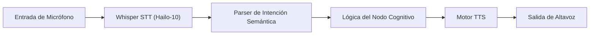

<!-- =============================================================================
HYDRA-UMC-VOICE-UI - Local speech-to-action front end
Copyright (C) JuanenRac (Electro Hobby 3D) <electrohobby3d@gmail.com>
GPL-3.0-or-later - see LICENSE
============================================================================= -->

<p align="center">
  
</p>

# 🎙️ HYDRA-UMC-VOICE-UI

<p align="center"><a href="README.md">🇺🇸 English</a> | 🇪🇸 <b>Español</b> | <a href="README_fra.md">🇫🇷 Français</a> | <a href="README_ita.md">🇮🇹 Italiano</a> | <a href="README_deu.md">🇩🇪 Deutsch</a> | <a href="README_zho.md">🇨🇳 简体中文</a> | <a href="README_jpn.md">🇯🇵 日本語</a> | <a href="README_por.md">🇵🇹 Português</a></p>

### 🔊 Pipeline de Speech-to-Action Local Acelerado por Hardware

<p align="center">
  
  
  
  
  
  
</p>

---

> **Estado de seguridad física y de ciberseguridad:** este ecosistema no es un sistema de seguridad certificado. Todavía no existe una ruta de E-STOP por hardware, ni límites ni enclavamientos aplicados por el firmware, ni un comando de movimiento verificado; las imágenes de firmware se comprueban con CRC-32 y una firma Ed25519, y una compilación de versión rechaza las claves de desarrollo publicadas (los cabezales de herramienta y las placas de expansión detrás del relé siguen con cargadores de URTC, que usan un HMAC-SHA256 de clave compartida en lugar de una firma); TLS y TLS mutuo son opcionales y están desactivados por defecto; aún no se ha poblado ni probado ninguna placa propia. Lee la [línea base de seguridad](https://github.com/JuanenRac/HYDRA-UMC-DOCS/blob/main/docs/SECURITY_BASELINE.md) y el [modelo de amenazas](https://github.com/JuanenRac/HYDRA-UMC-DOCS/blob/main/docs/THREAT_MODEL.md) antes de fiarte de cualquier afirmación de aquí para la seguridad de una persona.

---

## 📋 De un vistazo

| | |
|---|---|
| Versión | `0.2.0` |
| Madurez | Funcional |
| Tests | 255 (`python -m pytest -q tests`) |
| Tecnología | Python / Rule-based intent parser / Energy-gate VAD |
| Destino | La Raspberry Pi CM5 de una celda HYDRA-UMC |
| En hardware real | Todavía no: no consta ninguna ejecución en hardware real para esta versión |

**Ir a:** [Resumen](#-resumen) · [Arquitectura](#-arquitectura) · [Inicio rápido](#-inicio-rápido) · [Pruebas](#-pruebas) · [Estructura del repositorio](#-estructura-del-repositorio) · [Proyectos relacionados](#-proyectos-relacionados)

## 🚦 Estado del proyecto

Cada línea es una parte de este repositorio y la luz dice hasta dónde llega hoy. Se escribe con lo que el repositorio puede demostrar (pruebas, compilaciones, ejecuciones), no con lo previsto.

🟢 Hecho y verificado · 🟡 Funciona, con límites conocidos · 🟠 Hecho a medias o sin verificar · 🔴 Sin hacer o sin funcionar

| Área | Estado | Qué significa aquí |
|---|---|---|
| Software | 🟡 | Funciona para su propósito principal; la comprobación de honestidad de arriba lista lo que aún falta |
| Pruebas | 🟢 | 255 pruebas automáticas, ejecutadas en cada cambio |
| Hardware real | 🔴 | Todavía no: no consta ninguna ejecución en hardware real para esta versión |
| Documentación | 🟢 | README en ocho idiomas, comprobado contra el manifiesto en cada cambio |

## 🎯 Resumen

**HYDRA-UMC-VOICE-UI** es la capa de interacción por voz local para el ecosistema HYDRA-UMC. Proporciona un pipeline de STT (Speech-to-Text) y TTS (Text-to-Speech) de alto rendimiento acelerado por la NPU Hailo-10.

Permite a los operadores controlar misiones robóticas, consultar el estado del sistema y recibir feedback de audio sin ninguna conectividad a la nube, garantizando la máxima privacidad y latencia cero.

### Características Clave:
* 🎧 **Front-End de Audio (v0):** Carga real de WAV, solo stdlib, y deteccion de actividad de voz por umbral de energia. *(implementado como primitiva real de procesamiento de señal - no la transcripcion en si; ver BUILD Y EJECUCION abajo)*
* 🎙️ **STT en el Borde:** Modelos Whisper cuantizados para transcripción de voz casi instantánea. *(planeado - necesita una dependencia real de modelo)*
* 📢 **TTS Natural:** Síntesis de voz de alta calidad para alertas del sistema e informes de estado. *(planeado)*
* 🧠 **Parser NLU (v0):** Extraccion real de intencion/entidades del texto reconocido, basada en reglas, para el Planificador Semántico. *(implementado como reglas regex sobre un pequeño vocabulario real de comandos - no un modelo de ML entrenado; ver BUILD Y EJECUCION abajo)*
* 🔀 **Clasificación Consciente de Ambigüedad:** `classify_intent()` normaliza el texto (Unicode NFKC, eliminación de muletillas/puntuación) y rechaza una transcripción que realmente coincide con más de un comando conocido en vez de adivinar uno en silencio. *(implementado; usado por el gateway de voz para Watch más abajo)*
* 🔏 **Confirmaciones firmadas y de un solo uso (v0):** el `confirmationToken` que confirma una parada, el inicio de una misión o volver a casa va firmado con HMAC-SHA256 bajo una clave del servidor (`HYDRA_UMC_VOICE_UI_CONFIRM_SECRET`, de al menos 16 caracteres; sin ella se crea una clave aleatoria por proceso), lleva un nonce aleatorio y se acepta una sola vez: un segundo uso del mismo token, un token de otra intención armado a mano o uno firmado con otra clave se rechaza como `invalid`. Antes el token era un prefijo SHA-256 de su propio contenido sin secreto, así que cualquiera que conociera el formato podía fabricar una confirmación válida, y una válida podía repetirse durante sus 30 segundos. El instalador de OS genera la clave junto con los demás secretos del dispositivo. *(implementado)*
* 🛑 **Una parada por voz nunca se retiene (ajuste del servidor):** por defecto una petición de parada se responde al instante, sin token de confirmación y con `priority: safety-stop` para que un consumidor la convierta en una parada controlada (nunca sustituye a la parada de emergencia física); iniciar un movimiento sigue confirmándose. `HYDRA_UMC_VOICE_UI_STOP_REQUIRES_CONFIRMATION=1` devuelve la confirmación de la parada. *(implementado)*
* 🎚️ **Nivel de riesgo de cada acción por voz (un fichero):** una petición de estado es informativa y una parada se responde al instante; iniciar una misión e ir a casa son movimientos y exigen siempre confirmación. La tabla se lee de `HYDRA_UMC_VOICE_UI_RISK_FILE` (por defecto `/etc/hydra-umc/voice-ui-risk.json`, ejemplo en `deploy/voice-ui-risk.json.example`) y solo puede endurecer el valor por defecto: una entrada que rebaje una acción se ignora, y un fichero ausente o roto deja el valor por defecto.
* 🔏 **Una confirmación es para quien la pidió, y un resultado confirmado se puede verificar:** un turno puede nombrar su `subject` (el usuario con sesión iniciada para el que HYDRA-UMC-SERVER lo retransmite); el token de confirmación firmado lo lleva y confirma solo para ese mismo sujeto (un rechazo no consume el token). Un resultado confirmado lleva además `subject`, `confirmedAtUtc` y el `nonce` de un solo uso y, si `HYDRA_UMC_VOICE_UI_RESULT_KEY` (16 caracteres o más, el mismo valor que tiene HYDRA-UMC-SERVER) está definida, una `signature` HMAC-SHA256 que el servidor comprueba antes de creer el resultado. `HYDRA_UMC_VOICE_UI_REQUIRE_SUBJECT=1` rechaza además un turno o una confirmación que no nombre a nadie (desactivado por defecto). *(implementado)*
* 🙈 **La respuesta no repite lo que se dijo (ajuste del servidor):** por defecto la interpretación de una respuesta lista solo las reglas que coincidieron; `HYDRA_UMC_VOICE_UI_INCLUDE_HEARD_TEXT=1` añade la transcripción (`heardText`, `normalizedText`), que es un dato personal. Límites: las reglas solo entienden inglés y el `locale` de un turno se valida pero no se usa. El Server también puede fijarlo (y la confianza mínima) en cada turno desde su pantalla Server Admin; el entorno de este servicio gana sobre el Server.
* 🛡️ **Cancelación de Ruido:** Optimizado para entornos industriales con alto ruido ambiental. *(planeado)*
* 👨‍👩‍👧 **Hijo del Cognitive AI Node:** Corre como uno de los cuatro
  servicios hermanos bajo [HYDRA-UMC-COGNITIVE-NODE](https://github.com/JuanenRac/HYDRA-UMC-COGNITIVE-NODE)
  (junto a VLA-Engine, Semantic-Planner y Docs-QA), compartiendo la
  imagen HydraOS y los pesos de modelos de su padre en vez de mantener
  copias propias.
* 📦 **Versionado Cuentakilómetros:** La versión de `pyproject.toml` solo la sube el comando `bump` explícito (`python tools/hydra_project_tool.py bump`, que ejecuta `bump_version.py`) - compilar nunca la cambia.

## 🧩 Papel en HYDRA-UMC

**HYDRA-UMC-VOICE-UI** es la entrada de voz del nodo cognitivo: detecta voz en un fichero WAV, analiza con reglas un texto ya reconocido para sacar una intención y ofrece una pasarela HTTP acotada para el flujo del reloj que pide una confirmación antes de pasar nada. Todavía no reconoce el habla y nunca envía una orden física.

## 🏛️ Arquitectura

<p align="center">
  
</p>

<details>
<summary>Versión en texto del diagrama (Mermaid)</summary>



</details>

### ARQUITECTURA Y DECISIONES DE DISEÑO

Este repositorio es un **hijo** de la familia Cognitive AI Node - su
padre, [HYDRA-UMC-COGNITIVE-NODE](https://github.com/JuanenRac/HYDRA-UMC-COGNITIVE-NODE),
posee la imagen HydraOS compartida y los pesos de modelos cuantizados, y
conecta este servicio en su `docker-compose.yml` junto a sus tres
hermanos (VLA-Engine, Semantic-Planner, Docs-QA):

* **Por qué este hijo no tiene hardware/firmware/`os/`/`models/`
  propios.** Corre por completo sobre el módulo CM5 + Hailo-10 M.2 que ya
  posee el padre - centralizar los pesos de modelos y la imagen HydraOS
  en un solo lugar evita cuatro copias divergentes de varios gigabytes
  dentro de la familia.
* **Por qué una estructura `src/`.** Mantiene el paquete instalable
  (`hydra_umc_voice_ui`) separado del tooling en la raíz del repo
  (`bump_version.py`), igual que el resto de proyectos Python del
  ecosistema.
* **Por qué la invocación desnuda solo imprime identidad/versión/rol.**
  Eso sigue siendo una comprobación de andamiaje ligera y sin cambios; el
  trabajo real de v0 vive detrás de sus subcomandos: `analyze-audio`
  (carga real de WAV + detección de actividad de voz por umbral de
  energía, `audio.py`), `parse-intent` (análisis real de intención/entidad
  basado en reglas, `intent.py`), y `serve` (la puerta de enlace real y
  autenticada de turnos de voz para el Watch, `http_service.py`/
  `gateway.py`). Nada de eso es el pipeline de Whisper STT / TTS neuronal
  que describe el propio roadmap de este README - eso todavía necesita
  una dependencia real de modelo que este entorno no tiene.
* **Cómo encaja en el resto del ecosistema.** Este servicio es la puerta
  de entrada manos-libres a todo el Cognitive AI Node: la intención
  reconocida fluye hacia su hermano HYDRA-UMC-SEMANTIC-PLANNER, y actúa
  como superficie de control por voz junto a HYDRA-UMC-STUDIO y
  HYDRA-UMC-DSI.
* **Por qué `audio.py` usa `wave`/`array` en vez de numpy.** La
  decodificacion PCM de 16 bits y una VAD real por umbral de energia no
  necesitan nada mas alla de lo que ya ofrece la stdlib - mantener v0
  libre de dependencias significa que el front-end de audio real
  funciona en cualquier sitio donde corra Python, antes incluso de
  instalar ninguna dependencia especifica de STT para Hailo-10.
* **Por qué `intent.py` son reglas regex reales, no un modelo NLU
  entrenado.** Un vocabulario de comandos pequeño y real
  (start/stop/status/go home) queda cubierto por completo y de forma
  honesta con reglas hoy - el mismo razonamiento que el indice TF-IDF
  real del hermano HYDRA-UMC-DOCS-QA en vez de un modelo de embeddings:
  un nucleo real y testeable ahora que un futuro clasificador basado en
  ML puede sustituir detras del mismo contrato `parse_intent()`, cuando
  el habla reconocida necesite cubrir mas que este vocabulario de v0.
* **Por qué un audio/texto sin coincidencias devuelve un fallo honesto,
  no una suposición.** `detect_voice_segments()` devuelve una lista
  vacia para el silencio, y `parse_intent()` devuelve `None` para texto
  fuera de su conjunto de reglas - v0 no tiene un modelo de respaldo, asi
  que nunca inventa un segmento o una intencion que en realidad no
  detecto.
* **Por qué el gateway de Watch usa `classify_intent()`, no el
  `parse_intent()` heredado.** `parse_intent()` sigue siendo "primera
  coincidencia gana" (sin cambios, sigue testeado tal cual) para los
  llamantes existentes, pero una transcripción real que realmente
  coincide con más de un comando conocido (por ejemplo, que contiene
  tanto "stop" como "status") es una ambigüedad real y relevante para la
  seguridad en un gateway cuyo trabajo entero es decidir si un comando de
  movimiento necesita confirmación - `classify_intent()` comprueba todas
  las reglas y reporta un caso de ambigüedad real y distinto en vez de
  resolverlo en silencio a cualquiera que sea la regla declarada primero.
* **Por qué `normalize_text()` aplica Unicode NFKC antes de la
  coincidencia.** Algunos pipelines de speech-to-text emiten letras
  latinas de ancho completo y otras formas Unicode de compatibilidad -
  puntos de código distintos de los ASCII normales, y por tanto no son
  "la palabra" en lo que respecta a una expresión regular `\b...\b`.
  NFKC los colapsa primero a su equivalente normal, de modo que un
  comando semánticamente idéntico a una regla conocida nunca se trata
  como un fallo honesto solo por cómo fue codificado.

### GATEWAY DE VOZ PARA WATCH (v0)

`python -m hydra_umc_voice_ui.main serve` expone un gateway HTTP local y deliberadamente acotado para una integración emparejada con HYDRA-UMC-WATCH: `GET /health`, `POST /v1/voice/turn` y `POST /v1/voice/confirm`. El gateway valida el mensaje tipado `voice_turn`, usa el analizador de intenciones determinista existente y devuelve `assistant_reply`; no controla hardware del robot.

El desarrollo en loopback puede ejecutarse sin token. Una escucha fuera de loopback exige `HYDRA_UMC_VOICE_UI_TOKEN` y una cabecera `Authorization: Bearer` coincidente. Esta API nunca transporta audio en bruto y las intenciones relacionadas con movimiento siempre devuelven `requiresConfirmation: true` junto con un `confirmationToken` real y acotado: el cliente del Watch lo devuelve a `POST /v1/voice/confirm`, que informa `confirmed`/`expired`/`invalid` (nunca un booleano suelto) sin despachar nada por sí mismo. Consulta la sección de confirmación de [WATCH_VOICE_GATEWAY.md](docs/WATCH_VOICE_GATEWAY.md) más abajo para el contrato completo.

Una transcripción que realmente coincide con más de un comando conocido se rechaza con una respuesta real y distinta en vez de resolverse en silencio a una sola interpretación:

```json
// POST /v1/voice/turn
{"type": "voice_turn", "requestId": "watch-voice-001", "transcript": "stop the status check", "locale": "en-US"}

// -> {"type":"assistant_reply","requestId":"watch-voice-001","text":"That request matched more than one action (status, stop). Please rephrase it more specifically.","level":"ATTENTION","speak":true,"requiresConfirmation":false,"visualState":"clarification","interpretation":{"heardText":"stop the status check","normalizedText":"stop the status check","matchedRules":["status","stop"]}}
```

Consulta [WATCH_VOICE_GATEWAY.md](docs/WATCH_VOICE_GATEWAY.md) para el contrato de petición completo y el límite de despliegue, y [CLI_REFERENCE.md](docs/CLI_REFERENCE.md) para cada ejemplo real de `analyze-audio`/`parse-intent`/`serve` capturado desde el CLI instalado.

## 🚀 Inicio rápido

Requiere Python 3.10 o superior.

```bash
./build.sh  # Linux, macOS (build.bat on Windows)
./run.sh analyze-audio clip.wav
./run.sh parse-intent "stop robot one"
./run.sh serve --port 8091
```

## 🧪 Pruebas

255 pruebas automáticas se ejecutan con `python -m pytest -q tests`. No necesitan hardware ni nada fuera de esta máquina.

El CI ejecuta `HYDRA_UMC_CI=1 python tools/ci_validate.py`, que comprueba el manifiesto, los documentos, los ocho README y las imágenes.

## 🏗️ Compilación y publicación

Requiere Python >= 3.10.

```bash
# Linux / macOS / Git Bash
./build.sh   # crea .venv, instala el paquete (editable), verifica la importación
./run.sh     # ejecuta el punto de entrada

# Windows (cmd)
build.bat
run.bat
```

`build.sh`/`build.bat` nunca cambian la versión (solo `python tools/hydra_project_tool.py bump` la sube), y corren la suite de tests
real (`pytest tests/`). Salida esperada de un `run.sh` sin argumentos:

```text
HYDRA-UMC-VOICE-UI v0.2.0
Voice UI (Hailo-10) - local STT/TTS pipeline for hands-free robotic mission control.
```

Los subcomandos reales analizan un archivo WAV o parsean texto ya
transcrito:

```bash
./run.sh analyze-audio recordings/command.wav
./run.sh parse-intent "start mission alpha"

# Windows
run.bat analyze-audio recordings\command.wav
run.bat parse-intent "status of robot 3"
```

### 🩺 Solución de problemas

* **`python: comando no encontrado` / el build falla en el paso 1.**
  Requiere Python >= 3.10 en el `PATH`. En Windows, instálalo desde
  [python.org](https://python.org) y marca "Add to PATH" durante la
  instalación; en Linux/macOS suele llamarse `python3`.
* **`build.sh` no consigue activar el venv.** `python3 -m venv .venv`
  coloca el script de activación en una ruta distinta según la
  plataforma: `.venv/bin/activate` en Linux/macOS, `.venv/Scripts/activate`
  en Windows (también con un venv de Python de Windows usado desde Git
  Bash). `build.sh` ya comprueba ambas rutas - si sigue fallando, borra
  `.venv/` y vuelve a ejecutar `./build.sh` para reconstruirlo desde cero.
* **`pip install -e .` falla.** Normalmente por un `.venv/` obsoleto.
  Borra la carpeta `.venv/` y vuelve a ejecutar `./build.sh`/`build.bat`
  para recrearla.
* **`import OK` nunca se imprime.** Significa que `python -c "import
  hydra_umc_voice_ui"` falló - vuelve a ejecutarlo con el venv activo
  para ver el traceback real.

## 📂 Estructura del repositorio

<p align="center">
  
</p>

<details>
<summary>Versión en texto del árbol</summary>

```text
HYDRA-UMC-VOICE-UI/
├── src/hydra_umc_voice_ui/          código fuente
│   ├── __init__.py                  Descripción y versión del paquete
│   ├── audio.py                     Carga real de WAV + deteccion de actividad de voz por energia
│   ├── intent.py                    Parser real de intencion/entidades basado en reglas + classify_intent() consciente de ambigüedad
│   ├── gateway.py                   Puerta de enlace texto-a-intención acotada, compartida por el flujo cognitivo de Watch
│   ├── http_service.py              Pequeño límite HTTP de stdlib para la ruta de voz Watch-a-cognitivo
│   ├── main.py                      Punto de entrada + subcomandos reales `analyze-audio`/`parse-intent`
│   └── ratelimit.py                 Un límite de peticiones por dirección de cliente en ventana deslizante (para que un cliente no llene la lista de confirmaciones)
├── tests/                           Tests reales: fixtures WAV, VAD, reglas de intencion, gateway, CLI end-to-end
├── docs/                            Documentación y catálogo de comandos
├── images/                          Medios y diagramas
├── deploy/
├── systemd/                         unidad de servicio
├── tools/                           herramientas del proyecto y comprobaciones del CI
├── .github/                         flujo de CI y plantillas de incidencias
├── Dockerfile                       Imagen de contenedor mínima para el gateway HTTP autenticado (sin root)
├── pyproject.toml                   Metadatos del paquete (versión con incremento cuentakilómetros)
├── bump_version.py                  Incremento de versión tipo cuentakilómetros (solo lo ejecuta el comando `bump` explícito)
├── bump_manifest_version.py         Sincroniza la versión de hydra-umc.project.json con la nativa (--sync)
├── build.sh / build.bat             Crea el venv, instala (con extras de dev), verifica la importación, corre tests
├── build-test.sh / build-test.bat   Envoltorio no-mutante para tools/build_test.py (no toca version/manifest/CHANGELOG)
├── run.sh / run.bat                 Ejecuta el punto de entrada (reenvia argumentos, ej. `analyze-audio`)
├── CHANGELOG.md                     qué cambió en cada versión
├── hydra-umc.project.json           manifiesto: versión, madurez, familia
└── test.sh                          ejecuta las pruebas
```

</details>

## 🗺️ Hoja de ruta y límites conocidos

**Límites conocidos hoy**

* **Fase 1:** Despliegue del motor VLA y procesamiento de entrada multi-modal en Hailo-10.
* **Fase 2:** Integración del planificador semántico con modelos de comportamiento de enjambre y memoria a largo plazo.
* **Fase 3:** Ejecución local de baja latencia de Voice UI y cancelación de ruido industrial.
* **Fase 4:** Soporte multi-idioma (Inglés, Español, Alemán, Francés) e integración total con Dashboard AI.

## 🌍 Idiomas

Este README y los documentos del repositorio existen en ocho idiomas: inglés, español, alemán, francés, italiano, japonés, chino y portugués (Portugal). Se escriben a la vez y el CI comprueba que los ocho ficheros tengan las mismas secciones y los mismos enlaces. Este repositorio no tiene pantalla ni catálogo de mensajes propios, así que no hay cadenas de interfaz que traducir.

## 🔗 Proyectos relacionados

Este proyecto es parte del ecosistema de robótica HYDRA-UMC del mismo autor (JuanenRac / Electro Hobby 3D). Vale la pena conocerlo, ya que una petición podría en realidad ser sobre alguno de estos en vez de sobre este repositorio.

**Proyecto Padre**
- **[HYDRA-UMC-COGNITIVE-NODE](https://github.com/JuanenRac/HYDRA-UMC-COGNITIVE-NODE)** — nodo de integración para el pipeline cognitivo Hailo-10 (orquestación de LLM/VLA/voz); el padre del que este repositorio es una etapa o consumidor específico, dentro de su propio pipeline cognitivo.

**Proyectos Hermanos** — las demás etapas/consumidores del propio pipeline cognitivo Hailo-10 de HYDRA-UMC-COGNITIVE-NODE
- **[HYDRA-UMC-SEMANTIC-PLANNER](https://github.com/JuanenRac/HYDRA-UMC-SEMANTIC-PLANNER)** — descomposición real de tareas basada en reglas y recuperación semántica de errores sobre códigos de error del MCU.
- **[HYDRA-UMC-VLA-ENGINE](https://github.com/JuanenRac/HYDRA-UMC-VLA-ENGINE)** — codificación/decodificación real de tokens de acción y generación de trayectoria para un modelo Vision-Language-Action.
- **[HYDRA-UMC-DOCS-QA](https://github.com/JuanenRac/HYDRA-UMC-DOCS-QA)** — búsqueda real de documentos TF-IDF (solo librería estándar) sobre los propios documentos Markdown de este ecosistema.
- **[HYDRA-UMC-LOCAL-TECHNICIAN](https://github.com/JuanenRac/HYDRA-UMC-LOCAL-TECHNICIAN)** — técnico de mantenimiento con IA local y con puertas de política para el propio ecosistema - observa, diagnostica y propone arreglos; los dos niveles de riesgo más altos están deliberadamente sin implementar todavía.

**Directamente Relacionados**
- **[HYDRA-UMC-STUDIO](https://github.com/JuanenRac/HYDRA-UMC-STUDIO)** — panel de control web con visualización 3D multi-robot en tiempo real; otra superficie de control por voz del ecosistema, junto a este servicio.
- **[HYDRA-UMC-DSI](https://github.com/JuanenRac/HYDRA-UMC-DSI)** — interfaz táctil nativa para la pantalla táctil DSI de 7" a bordo, embebida en el propio CM5; otra superficie de control por voz del ecosistema, junto a este servicio.

**También Forma Parte del Ecosistema**

*Hardware y Plataforma Base*
- **[HYDRA-UMC](https://github.com/JuanenRac/HYDRA-UMC)** — el diseño de la placa madre del brazo robótico: host CM5 + coprocesador STM32H745 de doble núcleo, pensado para coordinar hasta 8 brazos herramienta por CAN-OTA/SPI-OTA (firmware en fase temprana; todavía no hay ninguna placa poblada).
- **[HYDRA-UMC-OS](https://github.com/JuanenRac/HYDRA-UMC-OS)** — capa de producto reproducible sobre Raspberry Pi OS para el CM5: agente de solo lectura, config/perfiles validados, aprovisionamiento WiFi de primer contacto.
- **[HYDRA-UMC-SDK](https://github.com/JuanenRac/HYDRA-UMC-SDK)** — el contrato JSON-Schema compartido y la barrera de software de puerta de trabajos contra la que cada bridge valida sus comandos (no es una función de seguridad certificada).
- **[HYDRA-UMC-CONNECTOR-HUB](https://github.com/JuanenRac/HYDRA-UMC-CONNECTOR-HUB)** — registro declarativo y validador de manifiestos de adaptador para conectores de máquinas externas; extiende la propia idea de contrato del SDK a máquinas externas sin sustituir a los proyectos de pasarela industrial.

*Backend Central y Clientes*
- **[HYDRA-UMC-SERVER](https://github.com/JuanenRac/HYDRA-UMC-SERVER)** — el backend headless real (REST/WebSocket) con el que habla de verdad cada cliente de control.
- **[HYDRA-UMC-SUITE](https://github.com/JuanenRac/HYDRA-UMC-SUITE)** — centro de mando de enjambre de escritorio (PySide6) para varios servidores a la vez, empaquetado como ejecutable independiente.
- **[HYDRA-UMC-ANDROID-CONTROL](https://github.com/JuanenRac/HYDRA-UMC-ANDROID-CONTROL)** — app nativa de control para Android con inicio de sesión biométrico y un compañero Wear OS emparejado.
- **[HYDRA-UMC-IOS-CONTROL](https://github.com/JuanenRac/HYDRA-UMC-IOS-CONTROL)** — app de control para iOS/iPadOS (Flutter) con sincronización en tiempo real por WebSocket.
- **[HYDRA-UMC-EDITOR-URDF](https://github.com/JuanenRac/HYDRA-UMC-EDITOR-URDF)** — creador/editor gráfico de URDF de escritorio que envía los modelos terminados al propio catálogo de STUDIO.
- **[HYDRA-UMC-EDITOR-STL](https://github.com/JuanenRac/HYDRA-UMC-EDITOR-STL)** — editor de escritorio de modelos STL, que transforma/reemplaza/quita/añade piezas reales en el mismo catálogo de modelos que también edita HYDRA-UMC-EDITOR-URDF.
- **[HYDRA-UMC-BRIDGE-AMR](https://github.com/JuanenRac/HYDRA-UMC-BRIDGE-AMR)** — barrera de coordinación para flotas AGV/AMR mediante un publicador MQTT VDA 5050 (probado solo contra una flota emulada).
- **[HYDRA-UMC-BRIDGE-CNC](https://github.com/JuanenRac/HYDRA-UMC-BRIDGE-CNC)** — coordinador de alto nivel para celdas CNC con acceso a estado/bytes de control GRBL (probado solo contra un emulador).
- **[HYDRA-UMC-BRIDGE-DROIDS](https://github.com/JuanenRac/HYDRA-UMC-BRIDGE-DROIDS)** — barrera de coordinación para droides con patas/humanoides, con un emisor de comandos para Boston Dynamics Spot (probado solo contra un emulador).
- **[HYDRA-UMC-BRIDGE-LASER](https://github.com/JuanenRac/HYDRA-UMC-BRIDGE-LASER)** — coordinador de celdas láser que lee 3 señales GPIO de llave/carcasa/enclavamiento (probado solo contra un chip simulado; no puede armar ni disparar un láser).
- **[HYDRA-UMC-BRIDGE-OPENPNP](https://github.com/JuanenRac/HYDRA-UMC-BRIDGE-OPENPNP)** — coordinador de alto nivel seguro para el flujo de placas de pick-and-place OpenPnP.
- **[HYDRA-UMC-BRIDGE-PRINTER3D](https://github.com/JuanenRac/HYDRA-UMC-BRIDGE-PRINTER3D)** — barrera de coordinación segura para impresoras 3D Moonraker/Klipper, con comandos de trabajo reales y controlados.
- **[HYDRA-UMC-BRIDGE-ROS2](https://github.com/JuanenRac/HYDRA-UMC-BRIDGE-ROS2)** — coordinador con un transporte ROS 2 rclpy importado de forma perezosa (todavía no ejecutado contra una instalación de ROS 2).
- **[HYDRA-UMC-BRIDGE-UAV](https://github.com/JuanenRac/HYDRA-UMC-BRIDGE-UAV)** — barrera de coordinación para UAV equipados con cámara, con un emisor de comandos MAVLink (probado solo contra un emulador).

*Plataforma de Herramientas URTC*
- **[URTC](https://github.com/JuanenRac/URTC)** — firmware para la placa física del Universal Robot Tool Controller, más de 25 perfiles de herramienta por bus CAN.
- **[URTC-FLASHER](https://github.com/JuanenRac/URTC-FLASHER)** — herramienta de escritorio con GUI para flashear placas URTC, CAN-OTA más SWD/JTAG de chip completo.
- **[URTC-TESTER](https://github.com/JuanenRac/URTC-TESTER)** — herramienta de escritorio de diagnóstico CAN-bus en vivo para placas URTC, un panel por perfil de herramienta.
- **[URTC-WEB-STUDIO](https://github.com/JuanenRac/URTC-WEB-STUDIO)** — alternativa basada en navegador a URTC-TESTER mediante la Web Serial API, sin instalación local.
- **[URTC-GATEWAY](https://github.com/JuanenRac/URTC-GATEWAY)** — pasarela delante del bus CAN de URTC: lista de identificadores permitidos, límite de tasa y clave de sesión; software probado en ordenador, aún no en un bus real.

*Nodo IA de Visión (Hailo-8)*
- **[HYDRA-UMC-VISION-NODE](https://github.com/JuanenRac/HYDRA-UMC-VISION-NODE)** — nodo de integración para el pipeline de visión Hailo-8, con una comprobación real de disponibilidad de hardware por etapa.
- **[HYDRA-UMC-DETECTION-HEF](https://github.com/JuanenRac/HYDRA-UMC-DETECTION-HEF)** — registro real de modelos compilados con verificación de carga segura por arquitectura Hailo/checksum.
- **[HYDRA-UMC-VISION-STREAMER](https://github.com/JuanenRac/HYDRA-UMC-VISION-STREAMER)** — generador real de pipeline GStreamer + config MediaMTX, con una frontera de integración HailoRT real.
- **[HYDRA-UMC-VISUAL-SERVOING-API](https://github.com/JuanenRac/HYDRA-UMC-VISUAL-SERVOING-API)** — ley de corrección Position-Based Visual Servoing con autorización condicionada al estado de zona; todavía sin estimación de pose por cámara.
- **[HYDRA-UMC-SAFETY-ZONES](https://github.com/JuanenRac/HYDRA-UMC-SAFETY-ZONES)** — lógica v0 de invasión de zona, vigencia de calibración y solicitud de E-STOP que toma las posiciones de los objetos de un fichero; ningún detector la alimenta y todavía no hay un E-STOP físico conectado.

*Orquestación y Enjambre*
- **[HYDRA-UMC-ORCHESTRATOR](https://github.com/JuanenRac/HYDRA-UMC-ORCHESTRATOR)** — nodo de integración con un contrato real de informe de salud gRPC/Protobuf y una máquina de estados de misión.
- **[HYDRA-UMC-JOB-DISPATCHER](https://github.com/JuanenRac/HYDRA-UMC-JOB-DISPATCHER)** — cola de trabajos real basada en prioridad con deduplicación, sobre una API HTTP real.
- **[HYDRA-UMC-NODE-HEALING](https://github.com/JuanenRac/HYDRA-UMC-NODE-HEALING)** — watchdog de salud de flota real basado en gRPC, con reintento/backoff y detección de discrepancia de identidad.
- **[HYDRA-UMC-PATH-PLANNER-3D](https://github.com/JuanenRac/HYDRA-UMC-PATH-PLANNER-3D)** — planificador de rutas 3D real basado en RRT, con validación real de colisión de obstáculos/espacio de trabajo.
- **[HYDRA-UMC-SWARM-SYNC](https://github.com/JuanenRac/HYDRA-UMC-SWARM-SYNC)** — sincronización de estado real mediante CRDT LWW-Element-Map, con pruebas de propiedades para convergencia multi-celda.

*Gemelo Digital y Simulación*
- **[HYDRA-UMC-TWIN](https://github.com/JuanenRac/HYDRA-UMC-TWIN)** — nodo de integración para el motor de gemelo digital, con un contrato real de sincronización por compatibilidad de versión.
- **[HYDRA-UMC-HIL-BRIDGE](https://github.com/JuanenRac/HYDRA-UMC-HIL-BRIDGE)** — enrutador hardware-in-the-loop con un enclavamiento de software por colisión entre simulación y hardware real (probado sin hardware real).
- **[HYDRA-UMC-PHYSICS-REPLICA](https://github.com/JuanenRac/HYDRA-UMC-PHYSICS-REPLICA)** — cinemática directa real y validación de límites articulares sobre un subconjunto real de URDF.
- **[HYDRA-UMC-SYNTHETIC-DATA-GEN](https://github.com/JuanenRac/HYDRA-UMC-SYNTHETIC-DATA-GEN)** — generador real de escenas 2D procedurales con exportación de anotaciones YOLO/COCO.

*Datos y Analítica*
- **[HYDRA-UMC-DATALAKE](https://github.com/JuanenRac/HYDRA-UMC-DATALAKE)** — almacén de series temporales real respaldado por sqlite3, con una API HTTP real de ingesta/consulta.
- **[HYDRA-UMC-ANOMALY-DETECTOR](https://github.com/JuanenRac/HYDRA-UMC-ANOMALY-DETECTOR)** — detector de anomalías real basado en FFT + línea base estadística, con monitorización de deriva.
- **[HYDRA-UMC-PRODUCTION-REPORTS](https://github.com/JuanenRac/HYDRA-UMC-PRODUCTION-REPORTS)** — cálculo real de OEE/disponibilidad sobre el histórico de DATALAKE, con exportación CSV reproducible.
- **[HYDRA-UMC-TELEMETRY-COLLECTOR](https://github.com/JuanenRac/HYDRA-UMC-TELEMETRY-COLLECTOR)** — pipeline real de ingesta CAN/WebSocket hacia DATALAKE, con deduplicación por secuencia.

*Pasarela Industrial*
- **[HYDRA-UMC-GATEWAY-INDUSTRIAL](https://github.com/JuanenRac/HYDRA-UMC-GATEWAY-INDUSTRIAL)** — nodo de integración que retransmite a protocolos industriales, con una capa real de lista blanca de comandos/contrapresión.
- **[HYDRA-UMC-OPCUA-SERVER](https://github.com/JuanenRac/HYDRA-UMC-OPCUA-SERVER)** — espacio de direcciones OPC-UA real, verificado con una sesión de cliente real del protocolo binario.
- **[HYDRA-UMC-MQTT-BROKER](https://github.com/JuanenRac/HYDRA-UMC-MQTT-BROKER)** — broker MQTT real con autenticación por cliente opcional y ACL de tópicos.
- **[HYDRA-UMC-MTCONNECT-ADAPTER](https://github.com/JuanenRac/HYDRA-UMC-MTCONNECT-ADAPTER)** — endpoints XML reales `/probe` y `/current` de MTConnect, con salida en modo degradado.

*Herramientas Complementarias y Operaciones del Ecosistema*
- **[HYDRA-UMC-DASHBOARD-AI](https://github.com/JuanenRac/HYDRA-UMC-DASHBOARD-AI)** — paneles de Resúmenes Inteligentes y Resaltado de Anomalías sobre DATALAKE/ANOMALY-DETECTOR, con un respaldo estadístico honesto.
- **[HYDRA-UMC-TOOL-CLI](https://github.com/JuanenRac/HYDRA-UMC-TOOL-CLI)** — CLI de flota con un contrato real y estable de códigos de salida, cliente real y en vivo de la propia API de HYDRA-UMC-SERVER.
- **[HYDRA-UMC-WATCH](https://github.com/JuanenRac/HYDRA-UMC-WATCH)** — app compañera de WearOS con patrones de alerta háptica y un relé de voz al teléfono emparejado (todavía no ejecutada en un reloj físico).
- **[URTC-SMART-RACK](https://github.com/JuanenRac/URTC-SMART-RACK)** — firmware para un rack de montaje de placas con decodificación real de ID de herramienta y lógica de precalentamiento Smart Idle.
- **[URTC-VISION-TOOL](https://github.com/JuanenRac/URTC-VISION-TOOL)** — firmware más un compañero de visión real en Python para un cabezal de inspección térmica/RGB.
- **[HYDRA-UMC-UPDATER](https://github.com/JuanenRac/HYDRA-UMC-UPDATER)** — herramienta administrativa de escritorio que descubre, clona y actualiza cada repositorio de este ecosistema.
- **[HYDRA-UMC-OS-REBUILDER](https://github.com/JuanenRac/HYDRA-UMC-OS-REBUILDER)** — herramienta de escritorio Windows/Linux que construye una imagen de la CM5 lista para grabar, precargada con las versiones más actuales del ecosistema, con configuración de primer arranque de Wi-Fi/usuario/SSH al estilo de Raspberry Pi Imager.
- **[HYDRA-UMC-OPS-AGENT](https://github.com/JuanenRac/HYDRA-UMC-OPS-AGENT)** — coordinador de incidencias de mantenimiento: un rol edge de bajo privilegio recopila un snapshot de inventario/salud saneado, un rol control-plane lo renderiza de solo lectura y pide a un proveedor de IA que sugiera un diagnóstico - nunca aplica un parche ni despliega nada.
- **[HYDRA-UMC-DEV-SERVER](https://github.com/JuanenRac/HYDRA-UMC-DEV-SERVER)** — host de desarrollo reproducible (Raspberry Pi 5 / CM5) que almacena el código del ecosistema y ejecuta tareas acotadas de compilación/pruebas bajo una cola duradera; un rol de desarrollo dedicado, explícitamente distinto de un CM5 operativo.

## 📚 Documentación

Dónde leer más:

* [Base de seguridad del ecosistema](https://github.com/JuanenRac/HYDRA-UMC-DOCS/blob/main/docs/SECURITY_BASELINE.md)
* [Modelo de amenazas del ecosistema](https://github.com/JuanenRac/HYDRA-UMC-DOCS/blob/main/docs/THREAT_MODEL.md)
* [Historial de cambios de este repositorio](CHANGELOG.md)
* [Licencia de este repositorio](LICENSE.md)

## 🤝 Contribuir y comunidad

* Antes de un pull request ejecuta `HYDRA_UMC_CI=1 py -3 tools/ci_validate.py` (o `HYDRA_UMC_CI=1 python3 tools/ci_validate.py`): debe imprimir `CI_VALIDATION=PASS`. No ejecutes `build.sh` ni `build.bat` para esta comprobación; compilar no es comprobar.
* Los ocho README se escriben desde una sola fuente en HYDRA-UMC-DOCS; no los edites a mano. Cambia la fuente y vuelve a escribirlos con `tools/make_readmes.py`.
* No afirmes en un README lo que no se ha ejecutado: di «simulado» o «sin probar en hardware» cuando esa sea la verdad.
* Mira [CONTRIBUTING.md](CONTRIBUTING.md), el [código de conducta](CODE_OF_CONDUCT.md), [SECURITY.md](SECURITY.md) y [SUPPORT.md](SUPPORT.md).

## 👤 AUTOR

**JuanenRac (Electro Hobby 3D)** · electrohobby3d@gmail.com

## 📜 LICENCIA

GPL-3.0-or-later - [LICENSE](LICENSE).
